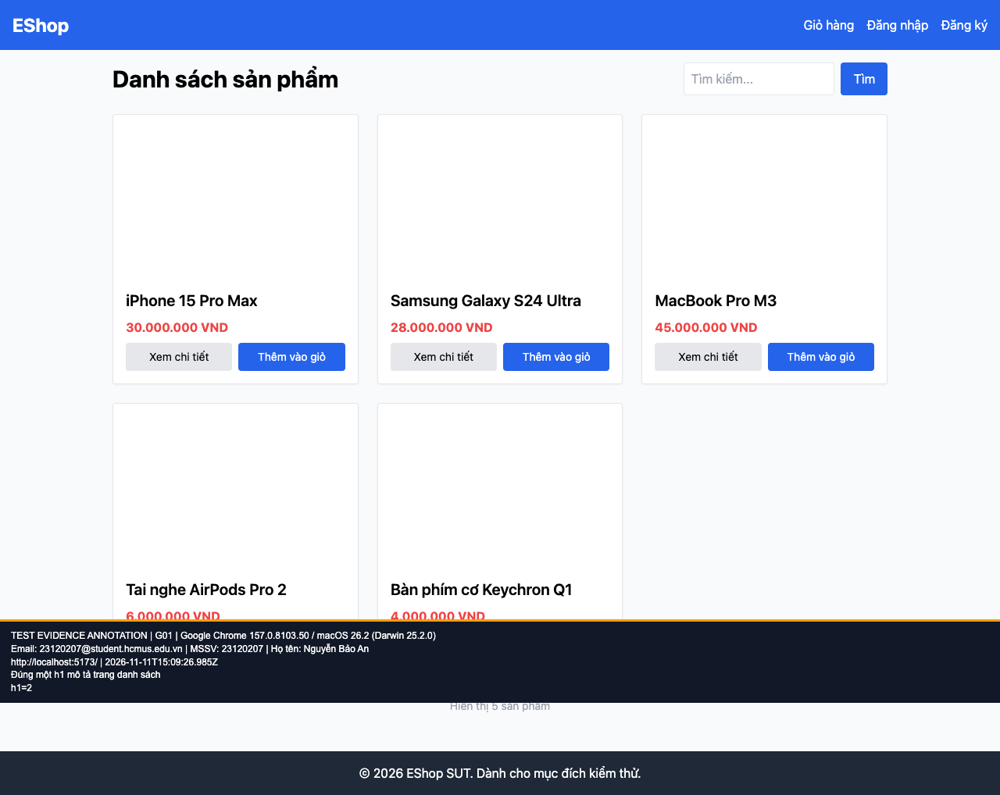

## B01: Home có hai h1 thay vì một

Severity: **Minor** (đề xuất, chưa có human review). Checklist: G01.

Nguồn kỳ vọng: FR-05; GUI §8.

Môi trường: Firefox (Playwright build) 153.0 / macOS 26.2 (Darwin 25.2.0); Google Chrome 157.0.8103.50 / macOS 26.2 (Darwin 25.2.0). SUT: `85af3ba875c88283615e22cb108f13e2fccaf0e9`.

Điều kiện: bản clone riêng, seed gốc, context mới, giỏ trống. Với case dữ liệu mạng, điều kiện giả lập được ghi trong bước.

Bước tái hiện: Mở danh sách sản phẩm. Kiểm tra heading trong main.

Kỳ vọng: Chỉ có một h1 mô tả trang.

Thực tế: Số h1 thực tế là 2.

GitHub Issue: https://github.com/NgBaoAnn/hw03-gui-usability/issues/1

Ảnh bằng chứng:

- chrome G01, 2026-11-11T15:09:27.074Z: [ảnh gốc](../evidence/gui/chrome/G01.png).
- firefox G01, 2026-11-11T15:09:28.206Z: [ảnh gốc](../evidence/gui/firefox/G01.png).

