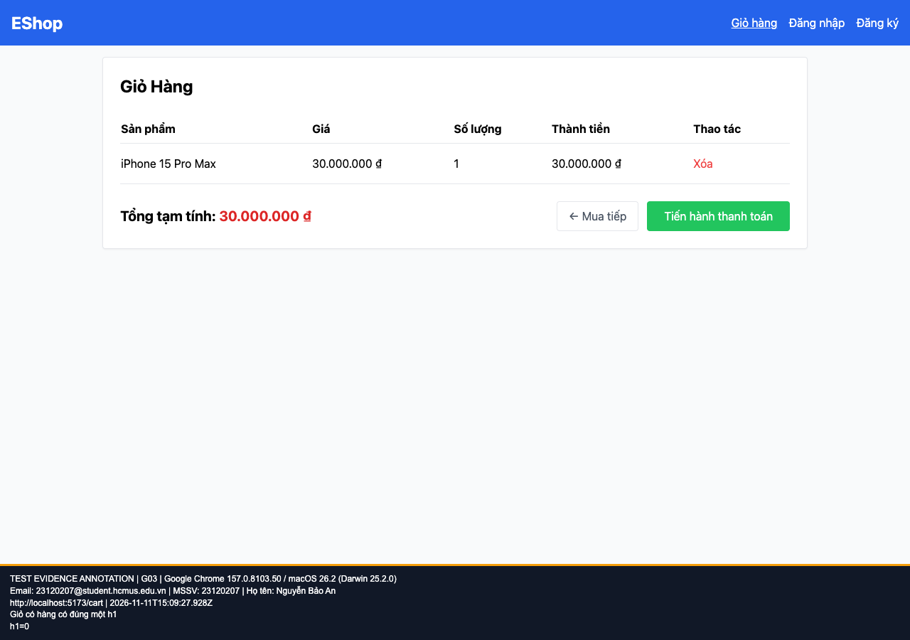

## B02: Giỏ hàng không có h1

Severity: **Minor** (đề xuất, chưa có human review). Checklist: G03.

Nguồn kỳ vọng: GUI §8.

Môi trường: Firefox (Playwright build) 153.0 / macOS 26.2 (Darwin 25.2.0); Google Chrome 157.0.8103.50 / macOS 26.2 (Darwin 25.2.0). SUT: `85af3ba875c88283615e22cb108f13e2fccaf0e9`.

Điều kiện: bản clone riêng, seed gốc, context mới, giỏ trống. Với case dữ liệu mạng, điều kiện giả lập được ghi trong bước.

Bước tái hiện: Từ Home thêm một sản phẩm, mở Giỏ hàng.

Kỳ vọng: Giỏ có một h1.

Thực tế: Giỏ có 0 h1.

GitHub Issue: https://github.com/NgBaoAnn/hw03-gui-usability/issues/2

Ảnh bằng chứng:

- chrome G03, 2026-11-11T15:09:28.046Z: [ảnh gốc](../evidence/gui/chrome/G03.png).
- firefox G03, 2026-11-11T15:09:29.974Z: [ảnh gốc](../evidence/gui/firefox/G03.png).

