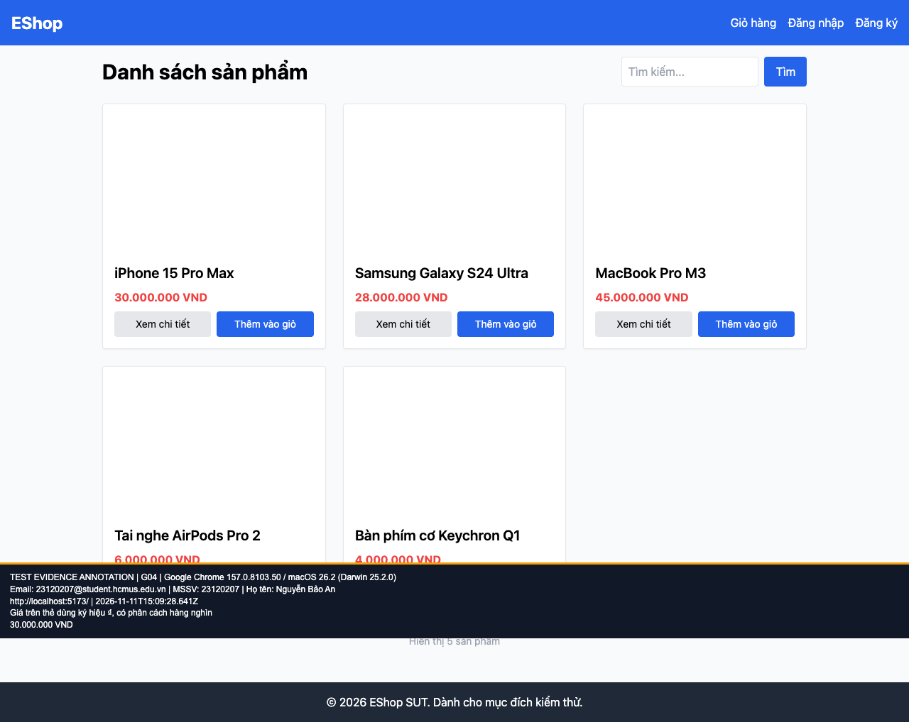

## B03: Thẻ sản phẩm dùng VND thay cho ký hiệu ₫

Severity: **Minor** (đề xuất, chưa có human review). Checklist: G04.

Nguồn kỳ vọng: FR-05; GUI §8.

Môi trường: Firefox (Playwright build) 153.0 / macOS 26.2 (Darwin 25.2.0); Google Chrome 157.0.8103.50 / macOS 26.2 (Darwin 25.2.0); Safari 26.2 (Apple safaridriver) / macOS 26.2. SUT: `85af3ba875c88283615e22cb108f13e2fccaf0e9`.

Điều kiện: bản clone riêng, seed gốc, context mới, giỏ trống. Với case dữ liệu mạng, điều kiện giả lập được ghi trong bước.

Bước tái hiện: Mở Home và so sánh giá trên thẻ với trang chi tiết.

Kỳ vọng: Giá dùng ₫ nhất quán.

Thực tế: Danh sách dùng VND, chi tiết dùng ₫.

GitHub Issue: https://github.com/NgBaoAnn/hw03-gui-usability/issues/3

Ảnh bằng chứng:

- chrome G04, 2026-11-11T15:09:28.707Z: [ảnh gốc](../evidence/gui/chrome/G04.png).
- firefox G04, 2026-11-11T15:09:30.505Z: [ảnh gốc](../evidence/gui/firefox/G04.png).
- safari G04, 2026-11-11T15:51:22.771583+00:00: [ảnh gốc](../evidence/gui/safari/G04.png).

