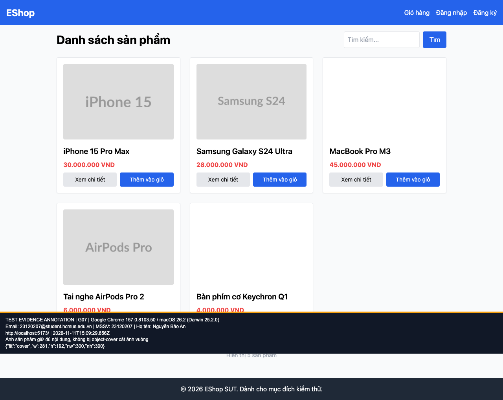

## B04: Ảnh vuông bị cắt trong khung ảnh danh sách

Severity: **Minor** (đề xuất, chưa có human review). Checklist: G07.

Nguồn kỳ vọng: FR-05; GUI §8.

Môi trường: Firefox (Playwright build) 153.0 / macOS 26.2 (Darwin 25.2.0); Google Chrome 157.0.8103.50 / macOS 26.2 (Darwin 25.2.0). SUT: `85af3ba875c88283615e22cb108f13e2fccaf0e9`.

Điều kiện: bản clone riêng, seed gốc, context mới, giỏ trống. Với case dữ liệu mạng, điều kiện giả lập được ghi trong bước.

Bước tái hiện: Mở Home, đối chiếu khung ảnh với ảnh gốc 300×300.

Kỳ vọng: Giữ nội dung ảnh theo tiêu chí kiểm thử về tỷ lệ.

Thực tế: object-cover trong khung 281×192 cắt ảnh vuông. Đây là phát hiện heuristic cần sinh viên duyệt mức ảnh hưởng.

GitHub Issue: https://github.com/NgBaoAnn/hw03-gui-usability/issues/4

Ảnh bằng chứng:

- chrome G07, 2026-11-11T15:09:29.909Z: [ảnh gốc](../evidence/gui/chrome/G07.png).
- firefox G07, 2026-11-11T15:09:32.712Z: [ảnh gốc](../evidence/gui/firefox/G07.png).

