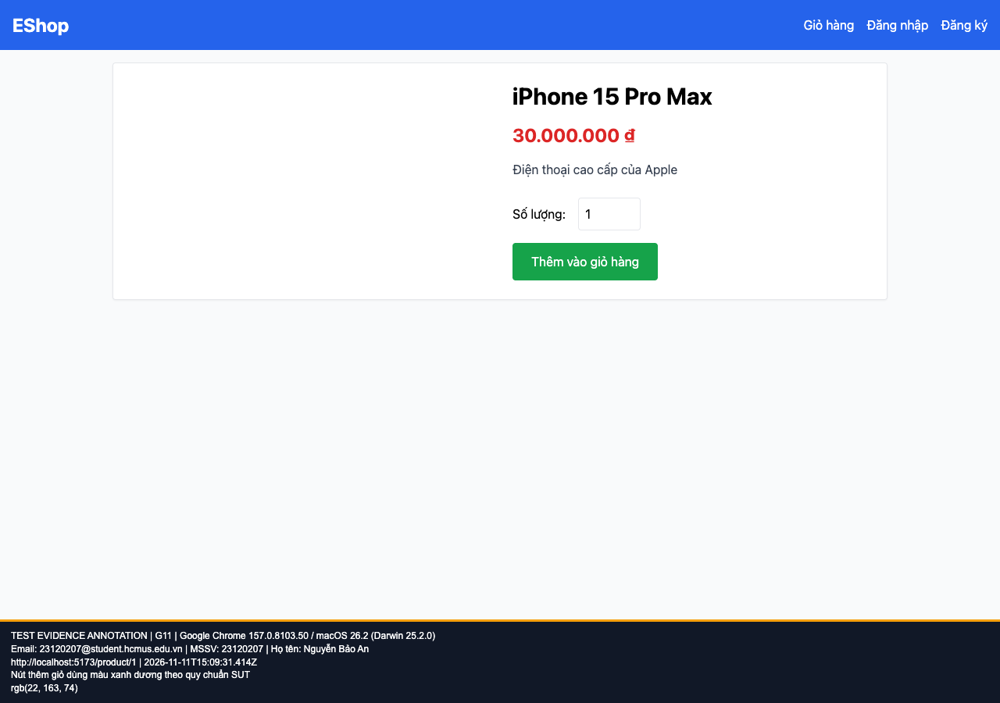

## B05: Nút thêm giỏ ở chi tiết dùng xanh lá thay vì xanh dương

Severity: **Minor** (đề xuất, chưa có human review). Checklist: G11.

Nguồn kỳ vọng: GUI §8.

Môi trường: Firefox (Playwright build) 153.0 / macOS 26.2 (Darwin 25.2.0); Google Chrome 157.0.8103.50 / macOS 26.2 (Darwin 25.2.0); Safari 26.2 (Apple safaridriver) / macOS 26.2. SUT: `85af3ba875c88283615e22cb108f13e2fccaf0e9`.

Điều kiện: bản clone riêng, seed gốc, context mới, giỏ trống. Với case dữ liệu mạng, điều kiện giả lập được ghi trong bước.

Bước tái hiện: Mở /product/1, quan sát màu nút thêm giỏ.

Kỳ vọng: Hành động tích cực dùng xanh dương theo GUI §8.

Thực tế: Nút có nền rgb(22,163,74).

GitHub Issue: https://github.com/NgBaoAnn/hw03-gui-usability/issues/5

Ảnh bằng chứng:

- chrome G11, 2026-11-11T15:09:31.473Z: [ảnh gốc](../evidence/gui/chrome/G11.png).
- firefox G11, 2026-11-11T15:09:35.885Z: [ảnh gốc](../evidence/gui/firefox/G11.png).
- safari G11, 2026-11-11T15:51:24.955264+00:00: [ảnh gốc](../evidence/gui/safari/G11.png).

