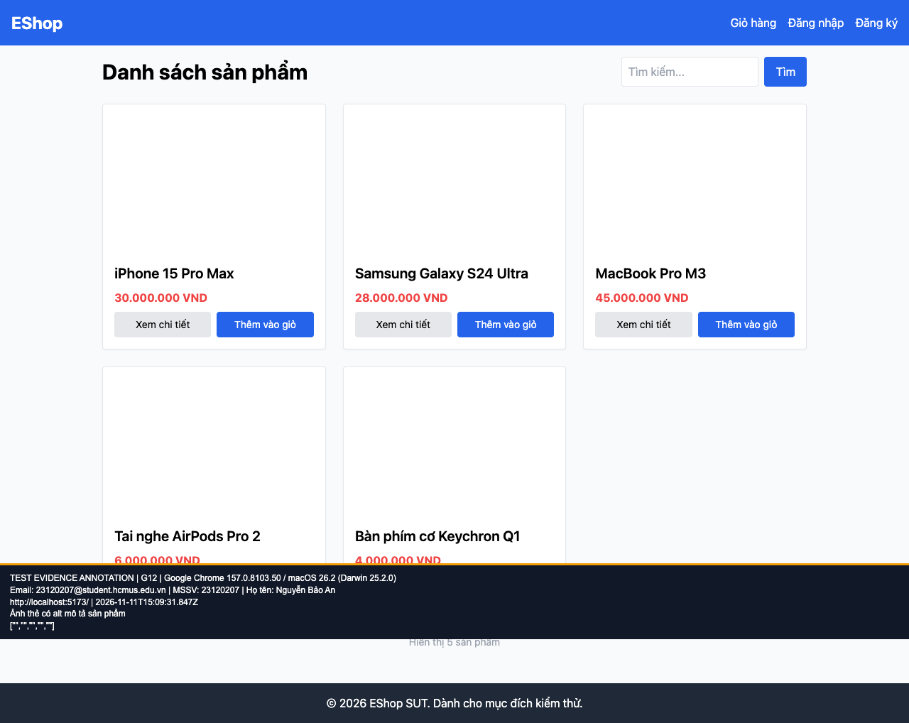

## B06: Tất cả ảnh sản phẩm danh sách có alt rỗng

Severity: **Major** (đề xuất, chưa có human review). Checklist: G12.

Nguồn kỳ vọng: FR-05; GUI §8.

Môi trường: Firefox (Playwright build) 153.0 / macOS 26.2 (Darwin 25.2.0); Google Chrome 157.0.8103.50 / macOS 26.2 (Darwin 25.2.0); Safari 26.2 (Apple safaridriver) / macOS 26.2. SUT: `85af3ba875c88283615e22cb108f13e2fccaf0e9`.

Điều kiện: bản clone riêng, seed gốc, context mới, giỏ trống. Với case dữ liệu mạng, điều kiện giả lập được ghi trong bước.

Bước tái hiện: Mở Home, kiểm tra thuộc tính alt của 5 ảnh thẻ.

Kỳ vọng: alt mô tả sản phẩm.

Thực tế: Cả 5 alt đều rỗng, ảnh bị coi là trang trí với công nghệ hỗ trợ.

GitHub Issue: https://github.com/NgBaoAnn/hw03-gui-usability/issues/6

Ảnh bằng chứng:

- chrome G12, 2026-11-11T15:09:31.938Z: [ảnh gốc](../evidence/gui/chrome/G12.png).
- firefox G12, 2026-11-11T15:09:36.414Z: [ảnh gốc](../evidence/gui/firefox/G12.png).
- safari G12, 2026-11-11T15:51:25.246119+00:00: [ảnh gốc](../evidence/gui/safari/G12.png).

