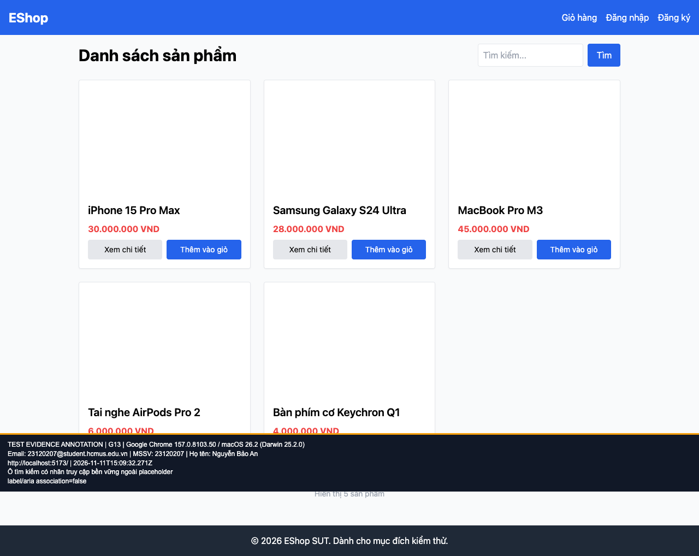

## B07: Ô tìm kiếm và số lượng thiếu nhãn truy cập được liên kết

Severity: **Major** (đề xuất, chưa có human review). Checklist: G13, G23.

Nguồn kỳ vọng: Heuristic: accessibility.

Môi trường: Firefox (Playwright build) 153.0 / macOS 26.2 (Darwin 25.2.0); Google Chrome 157.0.8103.50 / macOS 26.2 (Darwin 25.2.0). SUT: `85af3ba875c88283615e22cb108f13e2fccaf0e9`.

Điều kiện: bản clone riêng, seed gốc, context mới, giỏ trống. Với case dữ liệu mạng, điều kiện giả lập được ghi trong bước.

Bước tái hiện: Mở Home và /product/1; kiểm tra labels, aria-label, aria-labelledby của input.

Kỳ vọng: Mỗi trường có tên truy cập bền vững.

Thực tế: Tìm kiếm chỉ có placeholder; label Số lượng không liên kết input. Đây là kiểm tra DOM, chưa thay thế thử screen reader thật.

GitHub Issue: Chưa đăng

Ảnh bằng chứng:

- chrome G13, 2026-11-11T15:09:32.325Z: [ảnh gốc](../evidence/gui/chrome/G13.png).
- chrome G23, 2026-11-11T15:09:37.328Z: [ảnh gốc](../evidence/gui/chrome/G23.png).
- firefox G13, 2026-11-11T15:09:36.898Z: [ảnh gốc](../evidence/gui/firefox/G13.png).
- firefox G23, 2026-11-11T15:09:47.928Z: [ảnh gốc](../evidence/gui/firefox/G23.png).

