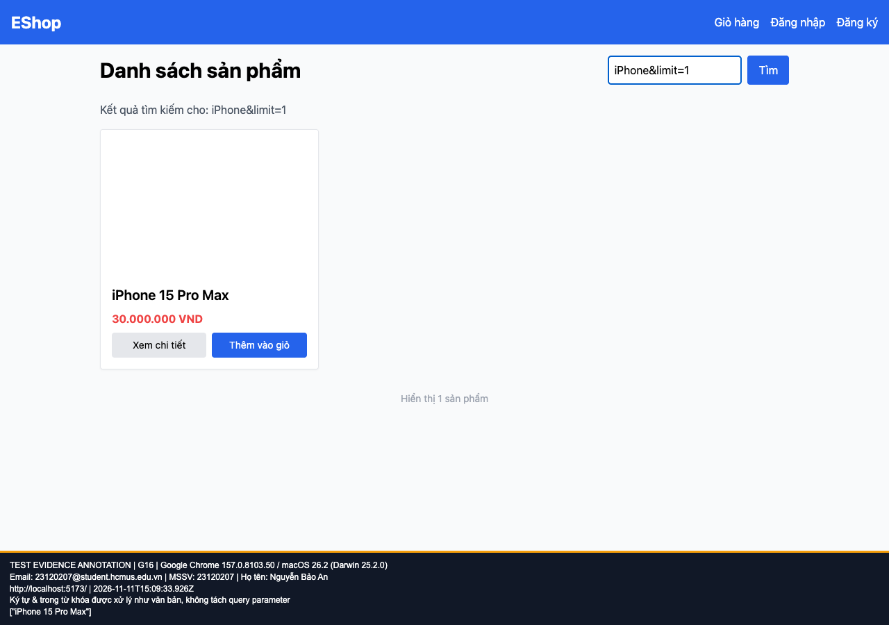

## B08: Ký tự & bị coi là dấu tách tham số trong từ khóa

Severity: **Major** (đề xuất, chưa có human review). Checklist: G16.

Nguồn kỳ vọng: FR-05.

Môi trường: Firefox (Playwright build) 153.0 / macOS 26.2 (Darwin 25.2.0); Google Chrome 157.0.8103.50 / macOS 26.2 (Darwin 25.2.0); Safari 26.2 (Apple safaridriver) / macOS 26.2. SUT: `85af3ba875c88283615e22cb108f13e2fccaf0e9`.

Điều kiện: bản clone riêng, seed gốc, context mới, giỏ trống. Với case dữ liệu mạng, điều kiện giả lập được ghi trong bước.

Bước tái hiện: Nhập iPhone&limit=1 ở Home, nhấn Enter.

Kỳ vọng: Tìm nguyên văn chuỗi; không sản phẩm nào khớp.

Thực tế: Vẫn trả iPhone vì query bị cắt tại &.

GitHub Issue: https://github.com/NgBaoAnn/hw03-gui-usability/issues/8

Ảnh bằng chứng:

- chrome G16, 2026-11-11T15:09:33.978Z: [ảnh gốc](../evidence/gui/chrome/G16.png).
- firefox G16, 2026-11-11T15:09:39.883Z: [ảnh gốc](../evidence/gui/firefox/G16.png).
- safari G16, 2026-11-11T15:51:27.468559+00:00: [ảnh gốc](../evidence/gui/safari/G16.png).

