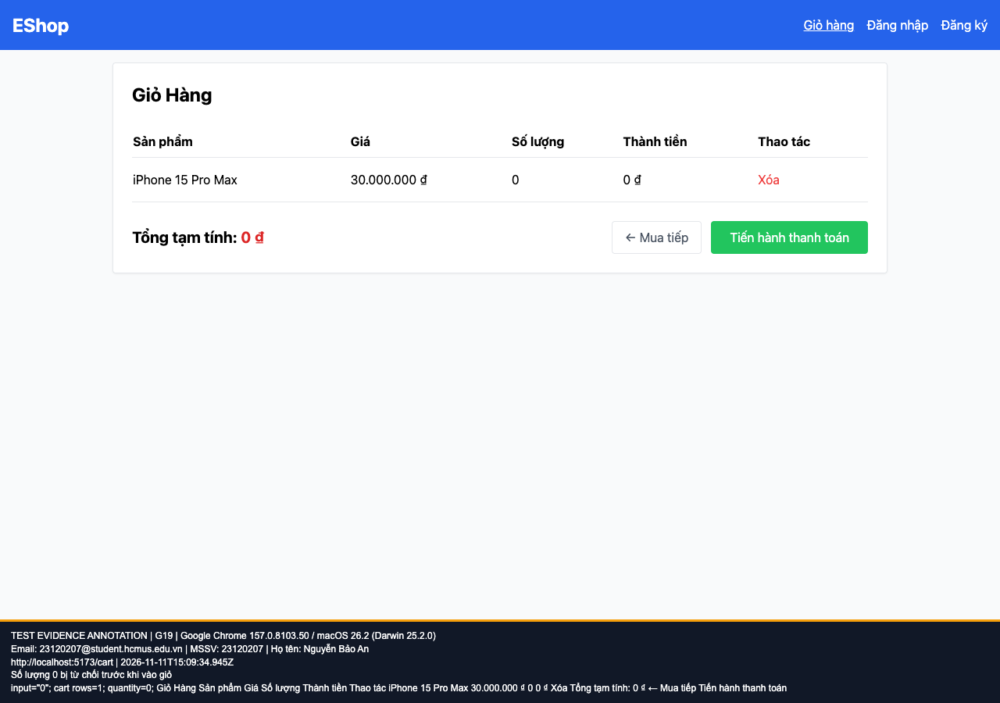

## B09: Số lượng không hợp lệ đi vào giỏ và sinh tổng âm hoặc NaN

Severity: **Major** (đề xuất, chưa có human review). Checklist: G19, G20, G21, G22.

Nguồn kỳ vọng: FR-06.

Môi trường: Firefox (Playwright build) 153.0 / macOS 26.2 (Darwin 25.2.0); Google Chrome 157.0.8103.50 / macOS 26.2 (Darwin 25.2.0); Safari 26.2 (Apple safaridriver) / macOS 26.2. SUT: `85af3ba875c88283615e22cb108f13e2fccaf0e9`.

Điều kiện: bản clone riêng, seed gốc, context mới, giỏ trống. Với case dữ liệu mạng, điều kiện giả lập được ghi trong bước.

Bước tái hiện: Mỗi lần mở mới /product/1; nhập 0, -1, 1.5 hoặc bỏ trống; bấm Thêm hai lần do B18; mở giỏ.

Kỳ vọng: Từ chối số lượng không phải số nguyên dương, hiển thị lỗi và không thay đổi giỏ.

Thực tế: Giỏ nhận 0, -1, làm tròn 1.5 thành 1, và ô trống thành NaN. Tổng âm hoặc NaN tương ứng.

GitHub Issue: https://github.com/NgBaoAnn/hw03-gui-usability/issues/9

Ảnh bằng chứng:

- chrome G19, 2026-11-11T15:09:34.997Z: [ảnh gốc](../evidence/gui/chrome/G19.png).
- chrome G20, 2026-11-11T15:09:35.847Z: [ảnh gốc](../evidence/gui/chrome/G20.png).
- chrome G21, 2026-11-11T15:09:36.371Z: [ảnh gốc](../evidence/gui/chrome/G21.png).
- chrome G22, 2026-11-11T15:09:36.847Z: [ảnh gốc](../evidence/gui/chrome/G22.png).
- firefox G19, 2026-11-11T15:09:41.971Z: [ảnh gốc](../evidence/gui/firefox/G19.png).
- firefox G20, 2026-11-11T15:09:42.634Z: [ảnh gốc](../evidence/gui/firefox/G20.png).
- firefox G21, 2026-11-11T15:09:45.842Z: [ảnh gốc](../evidence/gui/firefox/G21.png).
- firefox G22, 2026-11-11T15:09:46.530Z: [ảnh gốc](../evidence/gui/firefox/G22.png).
- safari G19, 2026-11-11T15:53:15.709264+00:00: [ảnh gốc](../evidence/gui/safari/G19.png).
- safari G20, 2026-11-11T15:53:16.503924+00:00: [ảnh gốc](../evidence/gui/safari/G20.png).
- safari G21, 2026-11-11T15:53:17.101448+00:00: [ảnh gốc](../evidence/gui/safari/G21.png).
- safari G22, 2026-11-11T15:53:17.791319+00:00: [ảnh gốc](../evidence/gui/safari/G22.png).

