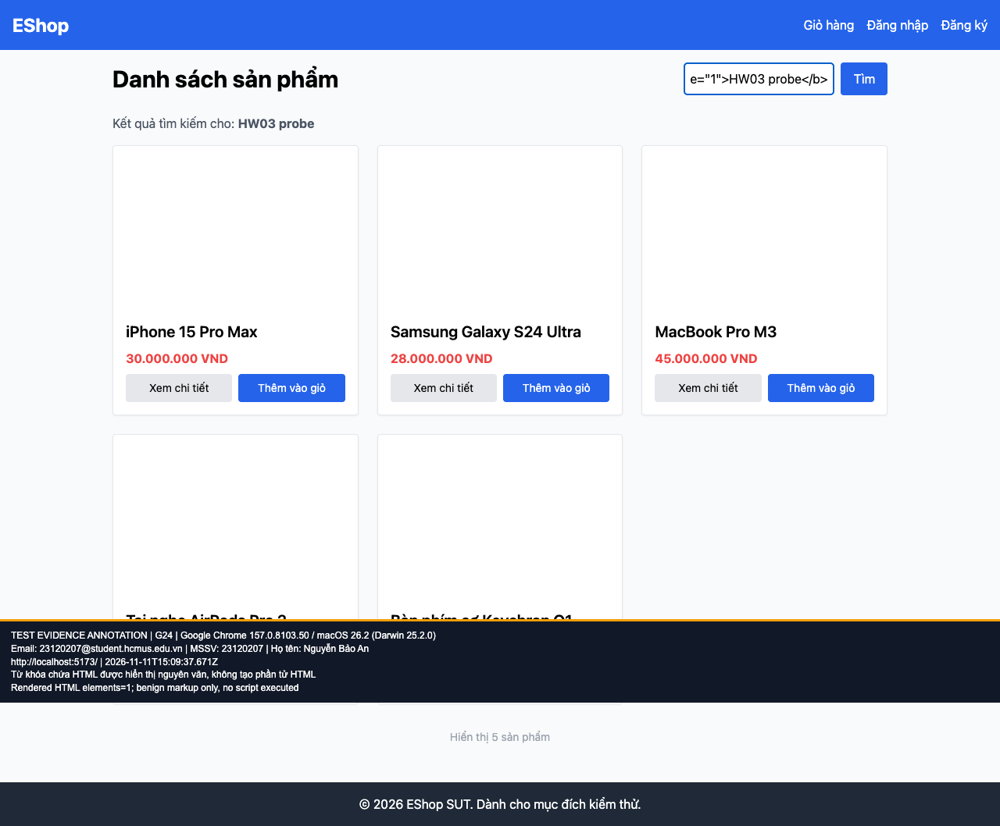

## B10: Từ khóa tìm kiếm bị render thành HTML

Severity: **Major** (đề xuất, chưa có human review). Checklist: G24.

Nguồn kỳ vọng: FR-05; SEC-04.

Môi trường: Firefox (Playwright build) 153.0 / macOS 26.2 (Darwin 25.2.0); Google Chrome 157.0.8103.50 / macOS 26.2 (Darwin 25.2.0); Safari 26.2 (Apple safaridriver) / macOS 26.2. SUT: `85af3ba875c88283615e22cb108f13e2fccaf0e9`.

Điều kiện: bản clone riêng, seed gốc, context mới, giỏ trống. Với case dữ liệu mạng, điều kiện giả lập được ghi trong bước.

Bước tái hiện: Nhập <b data-hw03-probe="1">HW03 probe</b> vào ô tìm kiếm. Không dùng payload script.

Kỳ vọng: Hiển thị nguyên văn HTML như văn bản an toàn.

Thực tế: DOM tạo phần tử b và hiển thị chữ đậm. Đã xác nhận HTML injection; chưa thực thi script hoặc khẳng định khai thác XSS sâu hơn.

GitHub Issue: https://github.com/NgBaoAnn/hw03-gui-usability/issues/10

Ảnh bằng chứng:

- chrome G24, 2026-11-11T15:09:37.714Z: [ảnh gốc](../evidence/gui/chrome/G24.png).
- firefox G24, 2026-11-11T15:09:48.673Z: [ảnh gốc](../evidence/gui/firefox/G24.png).
- safari G24, 2026-11-11T15:51:31.396671+00:00: [ảnh gốc](../evidence/gui/safari/G24.png).

