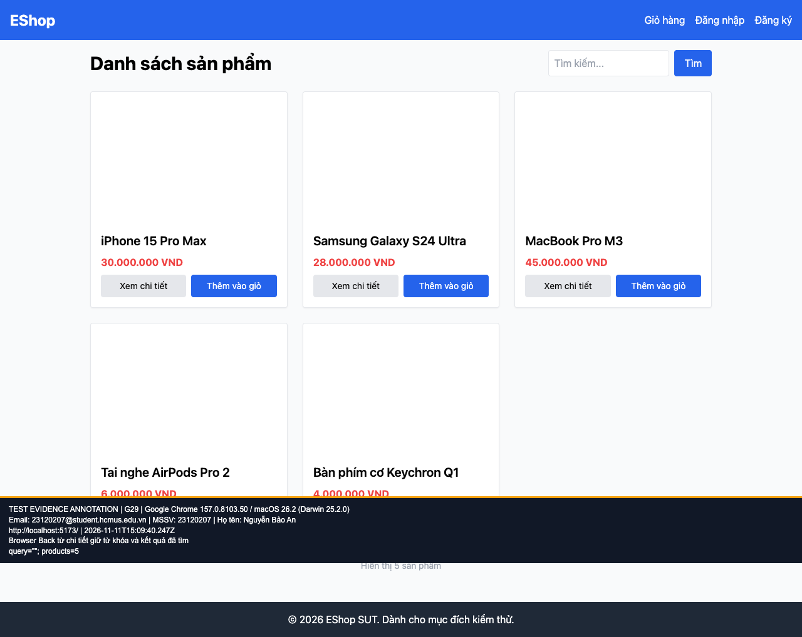

## B11: Browser Back làm mất từ khóa và tập kết quả

Severity: **Minor** (đề xuất, chưa có human review). Checklist: G29.

Nguồn kỳ vọng: Heuristic: continuity.

Môi trường: Firefox (Playwright build) 153.0 / macOS 26.2 (Darwin 25.2.0); Google Chrome 157.0.8103.50 / macOS 26.2 (Darwin 25.2.0); Safari 26.2 (Apple safaridriver) / macOS 26.2. SUT: `85af3ba875c88283615e22cb108f13e2fccaf0e9`.

Điều kiện: bản clone riêng, seed gốc, context mới, giỏ trống. Với case dữ liệu mạng, điều kiện giả lập được ghi trong bước.

Bước tái hiện: Tìm iPhone; mở chi tiết; dùng Browser Back.

Kỳ vọng: Giữ từ khóa và một kết quả theo heuristic duy trì ngữ cảnh.

Thực tế: Từ khóa rỗng và hiện lại 5 sản phẩm.

GitHub Issue: https://github.com/NgBaoAnn/hw03-gui-usability/issues/11

Ảnh bằng chứng:

- chrome G29, 2026-11-11T15:09:40.361Z: [ảnh gốc](../evidence/gui/chrome/G29.png).
- firefox G29, 2026-11-11T15:09:51.856Z: [ảnh gốc](../evidence/gui/firefox/G29.png).
- safari G29, 2026-11-11T15:59:28.651280+00:00: [ảnh gốc](../evidence/gui/safari/G29.png).

