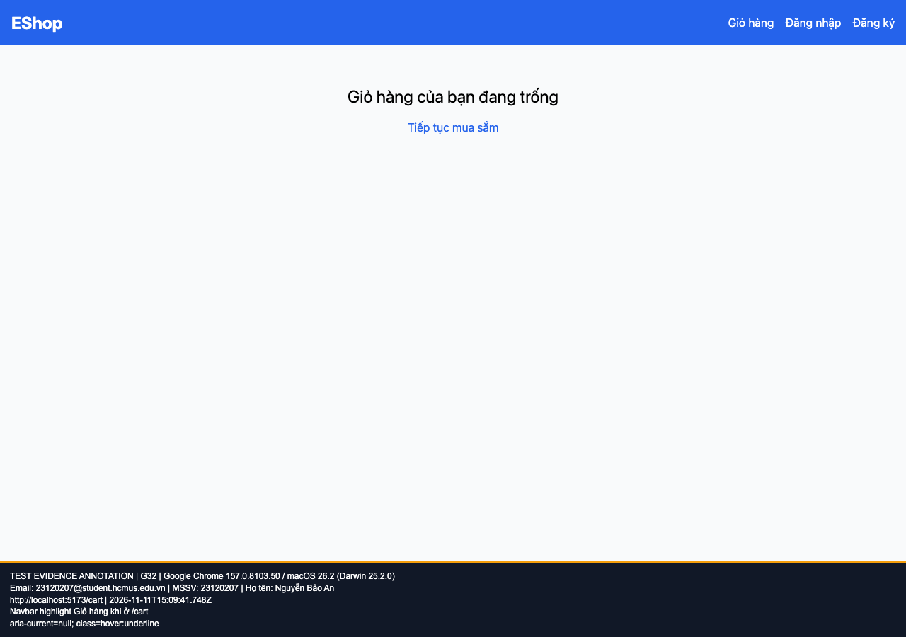

## B13: Navbar không highlight Giỏ hàng đang mở

Severity: **Minor** (đề xuất, chưa có human review). Checklist: G32.

Nguồn kỳ vọng: GUI §8.

Môi trường: Firefox (Playwright build) 153.0 / macOS 26.2 (Darwin 25.2.0); Google Chrome 157.0.8103.50 / macOS 26.2 (Darwin 25.2.0); Safari 26.2 (Apple safaridriver) / macOS 26.2. SUT: `85af3ba875c88283615e22cb108f13e2fccaf0e9`.

Điều kiện: bản clone riêng, seed gốc, context mới, giỏ trống. Với case dữ liệu mạng, điều kiện giả lập được ghi trong bước.

Bước tái hiện: Mở /cart, xem link Giỏ hàng.

Kỳ vọng: Có trạng thái được chọn và chỉ báo truy cập phù hợp.

Thực tế: Chỉ có hover:underline, không có highlight trang hiện tại.

GitHub Issue: https://github.com/NgBaoAnn/hw03-gui-usability/issues/13

Ảnh bằng chứng:

- chrome G32, 2026-11-11T15:09:41.791Z: [ảnh gốc](../evidence/gui/chrome/G32.png).
- firefox G32, 2026-11-11T15:09:56.097Z: [ảnh gốc](../evidence/gui/firefox/G32.png).
- safari G32, 2026-11-11T15:51:46.027308+00:00: [ảnh gốc](../evidence/gui/safari/G32.png).

