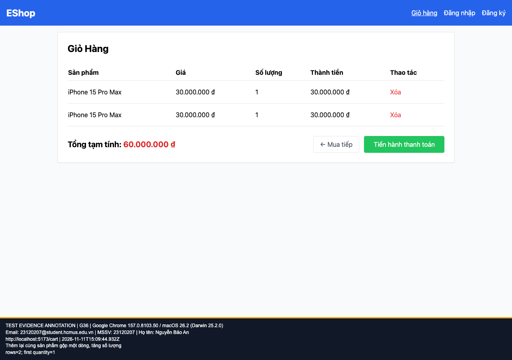

## B14: Thêm cùng sản phẩm hai lần tạo hai dòng giỏ

Severity: **Major** (đề xuất, chưa có human review). Checklist: G36.

Nguồn kỳ vọng: FR-07.

Môi trường: Firefox (Playwright build) 153.0 / macOS 26.2 (Darwin 25.2.0); Google Chrome 157.0.8103.50 / macOS 26.2 (Darwin 25.2.0); Safari 26.2 (Apple safaridriver) / macOS 26.2. SUT: `85af3ba875c88283615e22cb108f13e2fccaf0e9`.

Điều kiện: bản clone riêng, seed gốc, context mới, giỏ trống. Với case dữ liệu mạng, điều kiện giả lập được ghi trong bước.

Bước tái hiện: Ở Home bấm Thêm vào giỏ hai lần trên cùng thẻ; mở giỏ.

Kỳ vọng: Một dòng có số lượng 2.

Thực tế: Hai dòng cùng sản phẩm, mỗi dòng số lượng 1.

GitHub Issue: https://github.com/NgBaoAnn/hw03-gui-usability/issues/14

Ảnh bằng chứng:

- chrome G36, 2026-11-11T15:09:44.997Z: [ảnh gốc](../evidence/gui/chrome/G36.png).
- firefox G36, 2026-11-11T15:09:58.557Z: [ảnh gốc](../evidence/gui/firefox/G36.png).
- safari G36, 2026-11-11T15:51:48.068372+00:00: [ảnh gốc](../evidence/gui/safari/G36.png).

