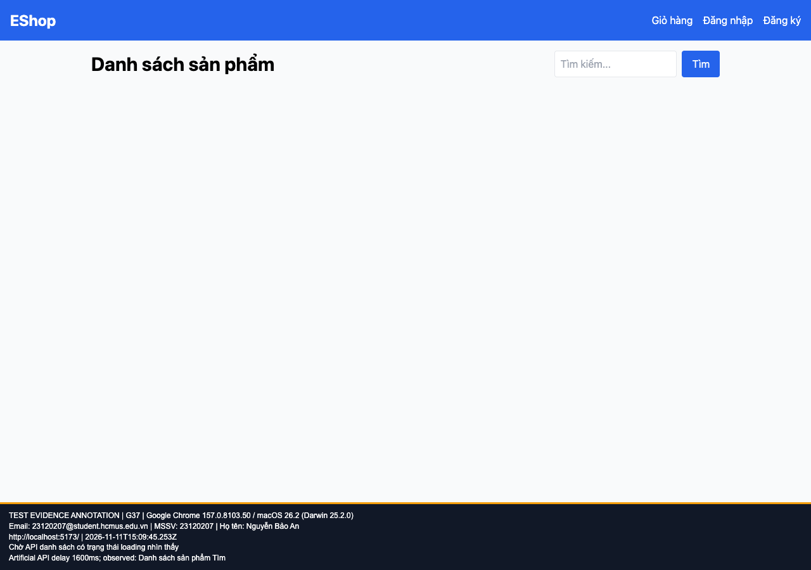

## B15: Danh sách thiếu loading khi đang chờ API

Severity: **Minor** (đề xuất, chưa có human review). Checklist: G37.

Nguồn kỳ vọng: FR-05.

Môi trường: Firefox (Playwright build) 153.0 / macOS 26.2 (Darwin 25.2.0); Google Chrome 157.0.8103.50 / macOS 26.2 (Darwin 25.2.0). SUT: `85af3ba875c88283615e22cb108f13e2fccaf0e9`.

Điều kiện: bản clone riêng, seed gốc, context mới, giỏ trống. Với case dữ liệu mạng, điều kiện giả lập được ghi trong bước.

Bước tái hiện: Giả lập trễ GET /api/products? 1600ms bằng Playwright, mở Home.

Kỳ vọng: Có thông báo/loading indicator khi chờ.

Thực tế: Chỉ có tiêu đề và form tìm kiếm trong thời gian chờ. Điều kiện mạng được mô phỏng có kiểm soát.

GitHub Issue: Chưa đăng

Ảnh bằng chứng:

- chrome G37, 2026-11-11T15:09:45.301Z: [ảnh gốc](../evidence/gui/chrome/G37.png).
- firefox G37, 2026-11-11T15:09:58.816Z: [ảnh gốc](../evidence/gui/firefox/G37.png).

