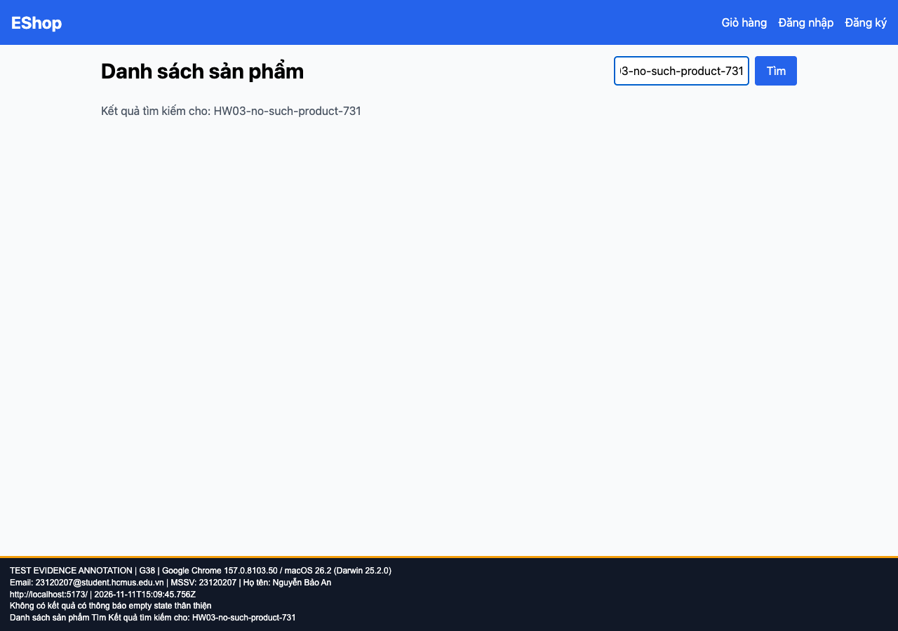

## B16: Không có kết quả tìm kiếm nhưng thiếu empty-state message

Severity: **Minor** (đề xuất, chưa có human review). Checklist: G38.

Nguồn kỳ vọng: FR-05; GUI §8.

Môi trường: Firefox (Playwright build) 153.0 / macOS 26.2 (Darwin 25.2.0); Google Chrome 157.0.8103.50 / macOS 26.2 (Darwin 25.2.0). SUT: `85af3ba875c88283615e22cb108f13e2fccaf0e9`.

Điều kiện: bản clone riêng, seed gốc, context mới, giỏ trống. Với case dữ liệu mạng, điều kiện giả lập được ghi trong bước.

Bước tái hiện: Tìm HW03-no-such-product-731.

Kỳ vọng: Thông báo thân thiện rằng không có kết quả.

Thực tế: Chỉ hiện dòng từ khóa, không có thông báo trạng thái rỗng.

GitHub Issue: Chưa đăng

Ảnh bằng chứng:

- chrome G38, 2026-11-11T15:09:45.810Z: [ảnh gốc](../evidence/gui/chrome/G38.png).
- firefox G38, 2026-11-11T15:09:59.244Z: [ảnh gốc](../evidence/gui/firefox/G38.png).

