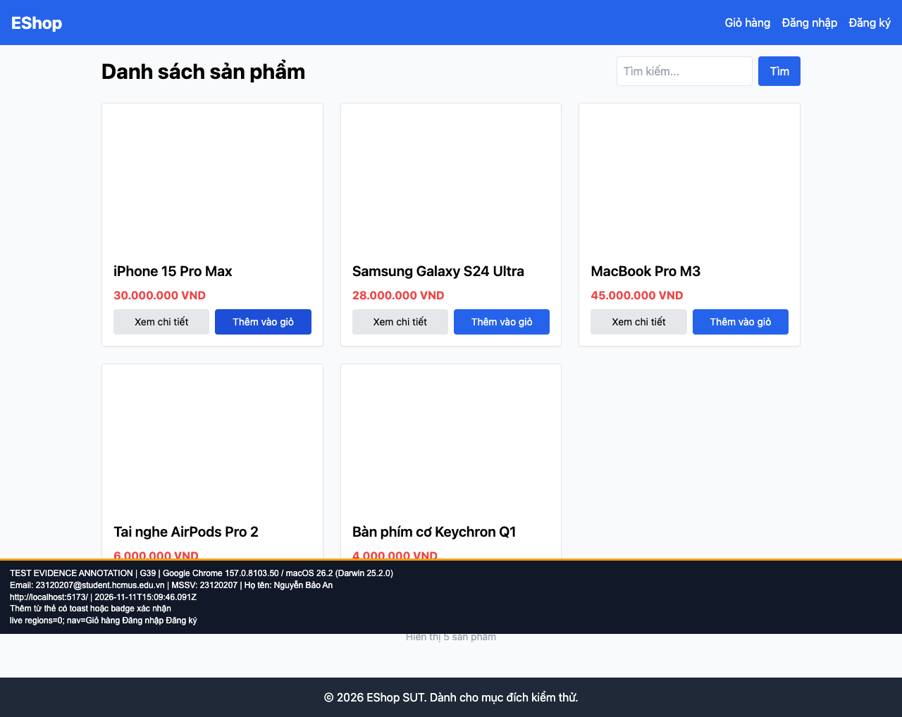

## B17: Thêm từ thẻ không có phản hồi và giỏ không có badge

Severity: **Major** (đề xuất, chưa có human review). Checklist: G39, G42.

Nguồn kỳ vọng: FR-06; GUI §8; GUI §8.

Môi trường: Firefox (Playwright build) 153.0 / macOS 26.2 (Darwin 25.2.0); Google Chrome 157.0.8103.50 / macOS 26.2 (Darwin 25.2.0). SUT: `85af3ba875c88283615e22cb108f13e2fccaf0e9`.

Điều kiện: bản clone riêng, seed gốc, context mới, giỏ trống. Với case dữ liệu mạng, điều kiện giả lập được ghi trong bước.

Bước tái hiện: Từ Home bấm Thêm vào giỏ một lần, quan sát màn hình và navbar.

Kỳ vọng: Toast/badge thông báo thêm thành công; link giỏ có số lượng.

Thực tế: Không có toast, vùng thông báo hoặc badge. Mở giỏ mới thấy sản phẩm đã được thêm.

GitHub Issue: Chưa đăng

Ảnh bằng chứng:

- chrome G39, 2026-11-11T15:09:46.187Z: [ảnh gốc](../evidence/gui/chrome/G39.png).
- chrome G42, 2026-11-11T15:09:48.731Z: [ảnh gốc](../evidence/gui/chrome/G42.png).
- firefox G39, 2026-11-11T15:09:59.924Z: [ảnh gốc](../evidence/gui/firefox/G39.png).
- firefox G42, 2026-11-11T15:10:03.684Z: [ảnh gốc](../evidence/gui/firefox/G42.png).

