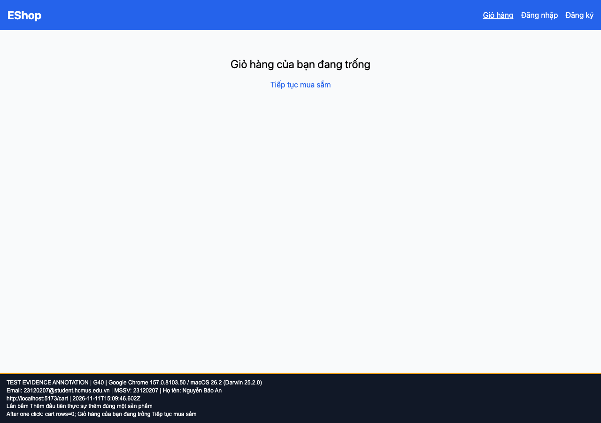

## B18: Lần bấm Thêm vào giỏ đầu tiên ở chi tiết không làm gì

Severity: **Major** (đề xuất, chưa có human review). Checklist: G40.

Nguồn kỳ vọng: FR-06.

Môi trường: Firefox (Playwright build) 153.0 / macOS 26.2 (Darwin 25.2.0); Google Chrome 157.0.8103.50 / macOS 26.2 (Darwin 25.2.0). SUT: `85af3ba875c88283615e22cb108f13e2fccaf0e9`.

Điều kiện: bản clone riêng, seed gốc, context mới, giỏ trống. Với case dữ liệu mạng, điều kiện giả lập được ghi trong bước.

Bước tái hiện: Mở mới /product/1; bấm Thêm vào giỏ hàng đúng một lần; mở Giỏ hàng.

Kỳ vọng: Giỏ có một sản phẩm ngay sau một lần bấm.

Thực tế: Giỏ trống. Bấm lần hai mới thêm và hiện Đã thêm.

GitHub Issue: Chưa đăng

Ảnh bằng chứng:

- chrome G40, 2026-11-11T15:09:46.649Z: [ảnh gốc](../evidence/gui/chrome/G40.png).
- firefox G40, 2026-11-11T15:10:00.442Z: [ảnh gốc](../evidence/gui/firefox/G40.png).

