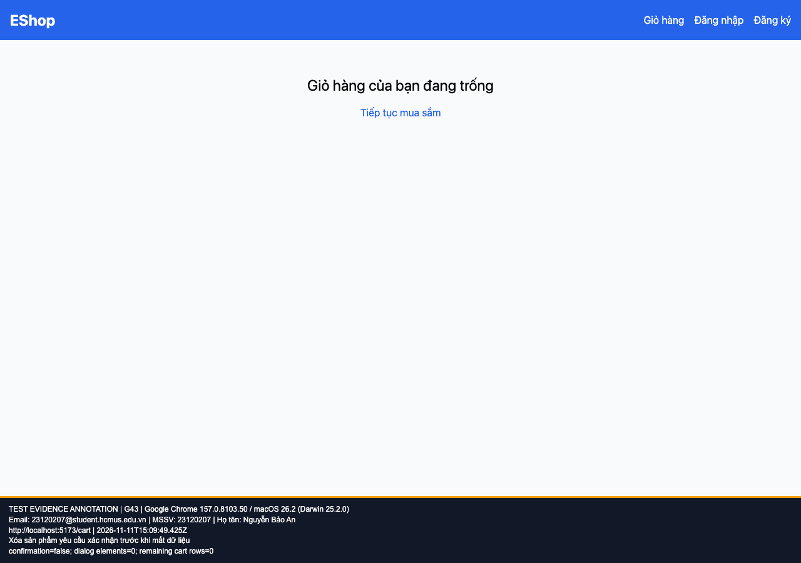

## B19: Xóa sản phẩm khỏi giỏ ngay lập tức không có xác nhận

Severity: **Major** (đề xuất, chưa có human review). Checklist: G43.

Nguồn kỳ vọng: FR-07; GUI §8.

Môi trường: Firefox (Playwright build) 153.0 / macOS 26.2 (Darwin 25.2.0); Google Chrome 157.0.8103.50 / macOS 26.2 (Darwin 25.2.0). SUT: `85af3ba875c88283615e22cb108f13e2fccaf0e9`.

Điều kiện: bản clone riêng, seed gốc, context mới, giỏ trống. Với case dữ liệu mạng, điều kiện giả lập được ghi trong bước.

Bước tái hiện: Từ Home thêm sản phẩm; mở giỏ; bấm Xóa.

Kỳ vọng: Hiện dialog xác nhận trước khi xóa.

Thực tế: Không có native dialog hay role=dialog; sản phẩm mất ngay.

GitHub Issue: https://github.com/NgBaoAnn/hw03-gui-usability/issues/19

Ảnh bằng chứng:

- chrome G43, 2026-11-11T15:09:49.468Z: [ảnh gốc](../evidence/gui/chrome/G43.png).
- firefox G43, 2026-11-11T15:10:04.116Z: [ảnh gốc](../evidence/gui/firefox/G43.png).

