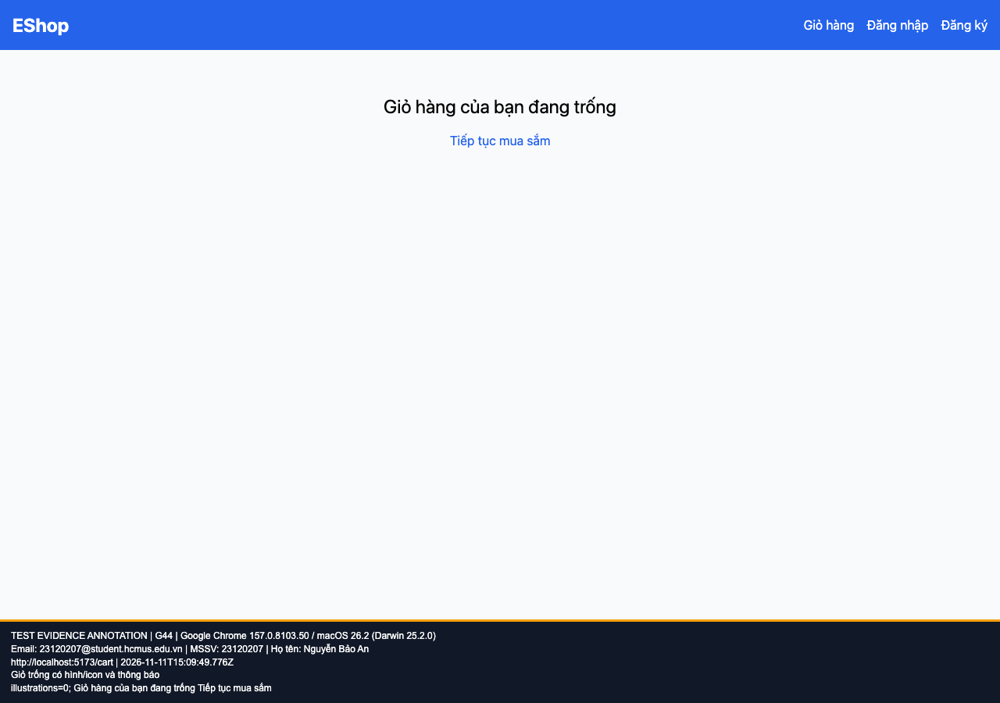

## B20: Giỏ trống thiếu hình minh họa hoặc icon

Severity: **Minor** (đề xuất, chưa có human review). Checklist: G44.

Nguồn kỳ vọng: FR-07; GUI §8.

Môi trường: Firefox (Playwright build) 153.0 / macOS 26.2 (Darwin 25.2.0); Google Chrome 157.0.8103.50 / macOS 26.2 (Darwin 25.2.0); Safari 26.2 (Apple safaridriver) / macOS 26.2. SUT: `85af3ba875c88283615e22cb108f13e2fccaf0e9`.

Điều kiện: bản clone riêng, seed gốc, context mới, giỏ trống. Với case dữ liệu mạng, điều kiện giả lập được ghi trong bước.

Bước tái hiện: Mở /cart trong context mới.

Kỳ vọng: Có thông báo kèm hình/icon theo FR-07.

Thực tế: Có câu thông báo nhưng không có hình/icon.

GitHub Issue: https://github.com/NgBaoAnn/hw03-gui-usability/issues/20

Ảnh bằng chứng:

- chrome G44, 2026-11-11T15:09:49.799Z: [ảnh gốc](../evidence/gui/chrome/G44.png).
- firefox G44, 2026-11-11T15:10:04.345Z: [ảnh gốc](../evidence/gui/firefox/G44.png).
- safari G44, 2026-11-11T15:51:52.151463+00:00: [ảnh gốc](../evidence/gui/safari/G44.png).

