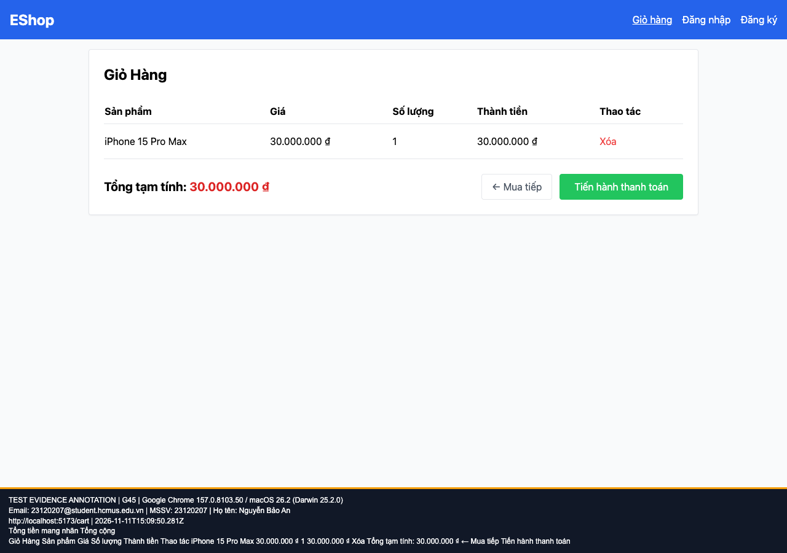

## B21: Giỏ dùng nhãn Tổng tạm tính thay cho Tổng cộng

Severity: **Minor** (đề xuất, chưa có human review). Checklist: G45.

Nguồn kỳ vọng: FR-07.

Môi trường: Firefox (Playwright build) 153.0 / macOS 26.2 (Darwin 25.2.0); Google Chrome 157.0.8103.50 / macOS 26.2 (Darwin 25.2.0). SUT: `85af3ba875c88283615e22cb108f13e2fccaf0e9`.

Điều kiện: bản clone riêng, seed gốc, context mới, giỏ trống. Với case dữ liệu mạng, điều kiện giả lập được ghi trong bước.

Bước tái hiện: Thêm sản phẩm từ Home rồi mở giỏ.

Kỳ vọng: Nhãn Tổng cộng theo FR-07.

Thực tế: Hiển thị Tổng tạm tính.

GitHub Issue: https://github.com/NgBaoAnn/hw03-gui-usability/issues/21

Ảnh bằng chứng:

- chrome G45, 2026-11-11T15:09:50.374Z: [ảnh gốc](../evidence/gui/chrome/G45.png).
- firefox G45, 2026-11-11T15:10:04.706Z: [ảnh gốc](../evidence/gui/firefox/G45.png).

