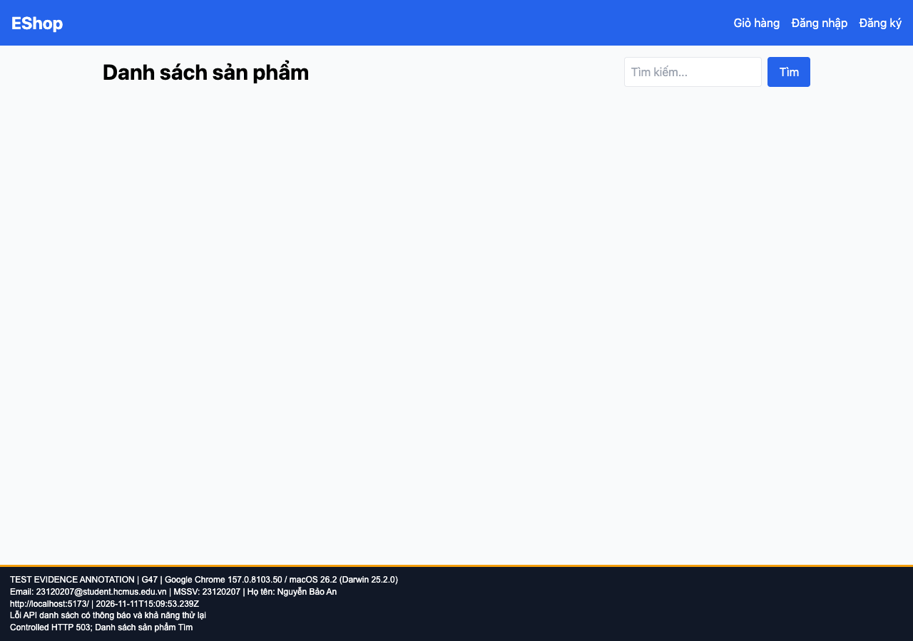

## B22: Lỗi API danh sách/chi tiết không có thông báo khôi phục

Severity: **Major** (đề xuất, chưa có human review). Checklist: G47, G48.

Nguồn kỳ vọng: Heuristic: error recovery.

Môi trường: Firefox (Playwright build) 153.0 / macOS 26.2 (Darwin 25.2.0); Google Chrome 157.0.8103.50 / macOS 26.2 (Darwin 25.2.0); Safari 26.2 (Apple safaridriver) / macOS 26.2. SUT: `85af3ba875c88283615e22cb108f13e2fccaf0e9`.

Điều kiện: bản clone riêng, seed gốc, context mới, giỏ trống. Với case dữ liệu mạng, điều kiện giả lập được ghi trong bước.

Bước tái hiện: Giả lập HTTP 503 JSON cho GET products hoặc products/1; mở trang tương ứng.

Kỳ vọng: Thông báo lỗi phù hợp, không chờ vô hạn và có cách tiếp tục.

Thực tế: Home trống dưới form; chi tiết kẹt Đang tải. Điều kiện lỗi mạng được mô phỏng có kiểm soát.

GitHub Issue: https://github.com/NgBaoAnn/hw03-gui-usability/issues/22

Ảnh bằng chứng:

- chrome G47, 2026-11-11T15:09:53.306Z: [ảnh gốc](../evidence/gui/chrome/G47.png).
- chrome G48, 2026-11-11T15:09:54.291Z: [ảnh gốc](../evidence/gui/chrome/G48.png).
- firefox G47, 2026-11-11T15:10:06.901Z: [ảnh gốc](../evidence/gui/firefox/G47.png).
- firefox G48, 2026-11-11T15:10:07.866Z: [ảnh gốc](../evidence/gui/firefox/G48.png).
- safari G47, 2026-11-11T15:51:55.055625+00:00: [ảnh gốc](../evidence/gui/safari/G47.png).
- safari G48, 2026-11-11T15:51:56.239739+00:00: [ảnh gốc](../evidence/gui/safari/G48.png).

