# Báo cáo lỗi GUI G2

SUT commit: `85af3ba875c88283615e22cb108f13e2fccaf0e9`. 23 nhóm lỗi từ 88 mục Failed của ba lượt chạy; không phải 88 bug độc lập. Chưa có phát hiện từ người tham gia usability. Severity do AI đề xuất, chờ sinh viên rà soát.

Các phát hiện heuristic được ghi rõ, không diễn giải thành yêu cầu FR bắt buộc. Ảnh gốc đính kèm từng báo cáo; xem JSON của môi trường để biết quan sát đầy đủ.

## B01: Home có hai h1 thay vì một

Severity: **Minor** (đề xuất, chưa có human review). Checklist: G01.

Nguồn kỳ vọng: FR-05; GUI §8.

Môi trường: Firefox (Playwright build) 153.0 / macOS 26.2 (Darwin 25.2.0); Google Chrome 157.0.8103.50 / macOS 26.2 (Darwin 25.2.0); Safari 26.2 (Apple safaridriver) / macOS 26.2. SUT: `85af3ba875c88283615e22cb108f13e2fccaf0e9`.

Điều kiện: bản clone riêng, seed gốc, context mới, giỏ trống. Với case dữ liệu mạng, điều kiện giả lập được ghi trong bước.

Bước tái hiện: Mở danh sách sản phẩm. Kiểm tra heading trong main.

Kỳ vọng: Chỉ có một h1 mô tả trang.

Thực tế: Số h1 thực tế là 2.

GitHub Issue: https://github.com/NgBaoAnn/hw03-gui-usability/issues/1

Ảnh bằng chứng:

- chrome G01, 2026-11-11T15:09:27.074Z: [ảnh gốc](../evidence/gui/chrome/G01.png).
- firefox G01, 2026-11-11T15:09:28.206Z: [ảnh gốc](../evidence/gui/firefox/G01.png).
- safari G01, 2026-11-11T15:51:18.417734+00:00: [ảnh gốc](../evidence/gui/safari/G01.png).

## B02: Giỏ hàng không có h1

Severity: **Minor** (đề xuất, chưa có human review). Checklist: G03.

Nguồn kỳ vọng: GUI §8.

Môi trường: Firefox (Playwright build) 153.0 / macOS 26.2 (Darwin 25.2.0); Google Chrome 157.0.8103.50 / macOS 26.2 (Darwin 25.2.0); Safari 26.2 (Apple safaridriver) / macOS 26.2. SUT: `85af3ba875c88283615e22cb108f13e2fccaf0e9`.

Điều kiện: bản clone riêng, seed gốc, context mới, giỏ trống. Với case dữ liệu mạng, điều kiện giả lập được ghi trong bước.

Bước tái hiện: Từ Home thêm một sản phẩm, mở Giỏ hàng.

Kỳ vọng: Giỏ có một h1.

Thực tế: Giỏ có 0 h1.

GitHub Issue: https://github.com/NgBaoAnn/hw03-gui-usability/issues/2

Ảnh bằng chứng:

- chrome G03, 2026-11-11T15:09:28.046Z: [ảnh gốc](../evidence/gui/chrome/G03.png).
- firefox G03, 2026-11-11T15:09:29.974Z: [ảnh gốc](../evidence/gui/firefox/G03.png).
- safari G03, 2026-11-11T15:51:22.075553+00:00: [ảnh gốc](../evidence/gui/safari/G03.png).

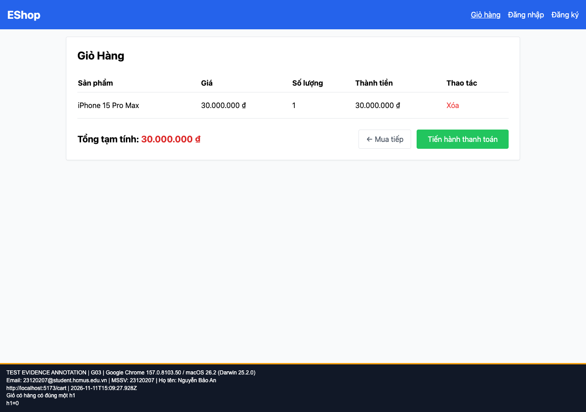

## B03: Thẻ sản phẩm dùng VND thay cho ký hiệu ₫

Severity: **Minor** (đề xuất, chưa có human review). Checklist: G04.

Nguồn kỳ vọng: FR-05; GUI §8.

Môi trường: Firefox (Playwright build) 153.0 / macOS 26.2 (Darwin 25.2.0); Google Chrome 157.0.8103.50 / macOS 26.2 (Darwin 25.2.0); Safari 26.2 (Apple safaridriver) / macOS 26.2. SUT: `85af3ba875c88283615e22cb108f13e2fccaf0e9`.

Điều kiện: bản clone riêng, seed gốc, context mới, giỏ trống. Với case dữ liệu mạng, điều kiện giả lập được ghi trong bước.

Bước tái hiện: Mở Home và so sánh giá trên thẻ với trang chi tiết.

Kỳ vọng: Giá dùng ₫ nhất quán.

Thực tế: Danh sách dùng VND, chi tiết dùng ₫.

GitHub Issue: https://github.com/NgBaoAnn/hw03-gui-usability/issues/3

Ảnh bằng chứng:

- chrome G04, 2026-11-11T15:09:28.707Z: [ảnh gốc](../evidence/gui/chrome/G04.png).
- firefox G04, 2026-11-11T15:09:30.505Z: [ảnh gốc](../evidence/gui/firefox/G04.png).
- safari G04, 2026-11-11T15:51:22.771583+00:00: [ảnh gốc](../evidence/gui/safari/G04.png).

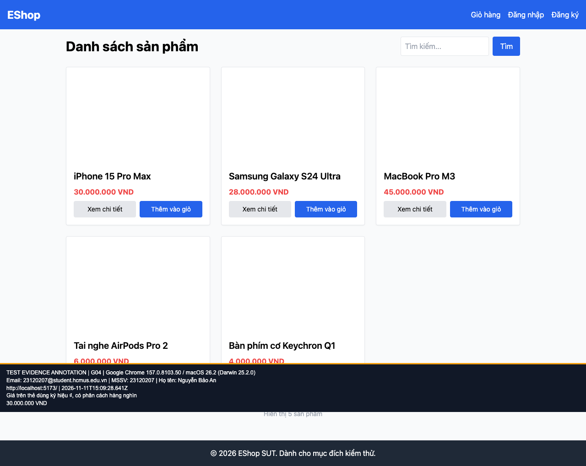

## B04: Ảnh vuông bị cắt trong khung ảnh danh sách

Severity: **Minor** (đề xuất, chưa có human review). Checklist: G07.

Nguồn kỳ vọng: FR-05; GUI §8.

Môi trường: Firefox (Playwright build) 153.0 / macOS 26.2 (Darwin 25.2.0); Google Chrome 157.0.8103.50 / macOS 26.2 (Darwin 25.2.0); Safari 26.2 (Apple safaridriver) / macOS 26.2. SUT: `85af3ba875c88283615e22cb108f13e2fccaf0e9`.

Điều kiện: bản clone riêng, seed gốc, context mới, giỏ trống. Với case dữ liệu mạng, điều kiện giả lập được ghi trong bước.

Bước tái hiện: Mở Home, đối chiếu khung ảnh với ảnh gốc 300×300.

Kỳ vọng: Giữ nội dung ảnh theo tiêu chí kiểm thử về tỷ lệ.

Thực tế: object-cover trong khung 281×192 cắt ảnh vuông. Đây là phát hiện heuristic cần sinh viên duyệt mức ảnh hưởng.

GitHub Issue: https://github.com/NgBaoAnn/hw03-gui-usability/issues/4

Ảnh bằng chứng:

- chrome G07, 2026-11-11T15:09:29.909Z: [ảnh gốc](../evidence/gui/chrome/G07.png).
- firefox G07, 2026-11-11T15:09:32.712Z: [ảnh gốc](../evidence/gui/firefox/G07.png).
- safari G07, 2026-11-11T15:51:23.958154+00:00: [ảnh gốc](../evidence/gui/safari/G07.png).

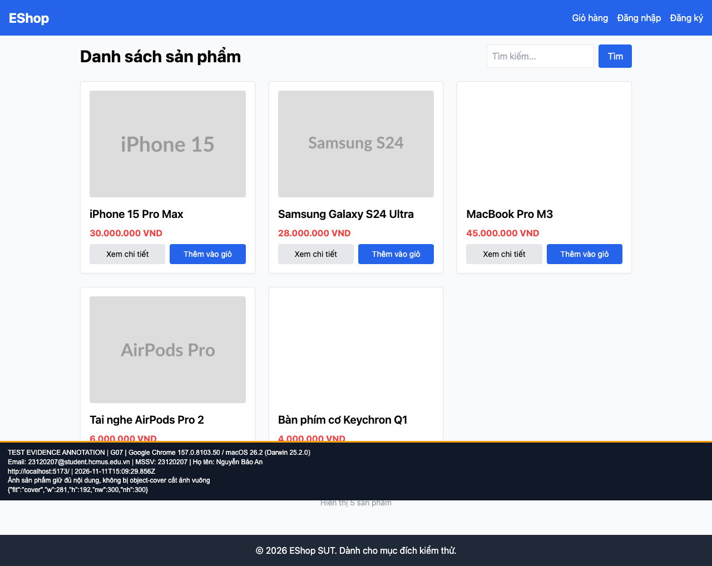

## B05: Nút thêm giỏ ở chi tiết dùng xanh lá thay vì xanh dương

Severity: **Minor** (đề xuất, chưa có human review). Checklist: G11.

Nguồn kỳ vọng: GUI §8.

Môi trường: Firefox (Playwright build) 153.0 / macOS 26.2 (Darwin 25.2.0); Google Chrome 157.0.8103.50 / macOS 26.2 (Darwin 25.2.0); Safari 26.2 (Apple safaridriver) / macOS 26.2. SUT: `85af3ba875c88283615e22cb108f13e2fccaf0e9`.

Điều kiện: bản clone riêng, seed gốc, context mới, giỏ trống. Với case dữ liệu mạng, điều kiện giả lập được ghi trong bước.

Bước tái hiện: Mở /product/1, quan sát màu nút thêm giỏ.

Kỳ vọng: Hành động tích cực dùng xanh dương theo GUI §8.

Thực tế: Nút có nền rgb(22,163,74).

GitHub Issue: https://github.com/NgBaoAnn/hw03-gui-usability/issues/5

Ảnh bằng chứng:

- chrome G11, 2026-11-11T15:09:31.473Z: [ảnh gốc](../evidence/gui/chrome/G11.png).
- firefox G11, 2026-11-11T15:09:35.885Z: [ảnh gốc](../evidence/gui/firefox/G11.png).
- safari G11, 2026-11-11T15:51:24.955264+00:00: [ảnh gốc](../evidence/gui/safari/G11.png).

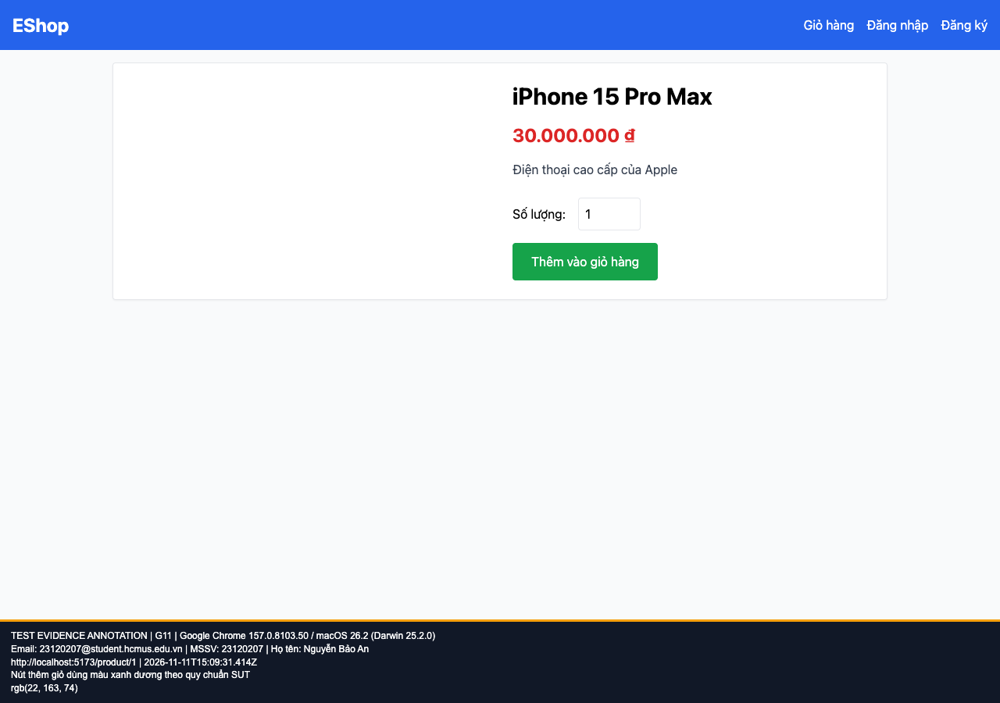

## B06: Tất cả ảnh sản phẩm danh sách có alt rỗng

Severity: **Major** (đề xuất, chưa có human review). Checklist: G12.

Nguồn kỳ vọng: FR-05; GUI §8.

Môi trường: Firefox (Playwright build) 153.0 / macOS 26.2 (Darwin 25.2.0); Google Chrome 157.0.8103.50 / macOS 26.2 (Darwin 25.2.0); Safari 26.2 (Apple safaridriver) / macOS 26.2. SUT: `85af3ba875c88283615e22cb108f13e2fccaf0e9`.

Điều kiện: bản clone riêng, seed gốc, context mới, giỏ trống. Với case dữ liệu mạng, điều kiện giả lập được ghi trong bước.

Bước tái hiện: Mở Home, kiểm tra thuộc tính alt của 5 ảnh thẻ.

Kỳ vọng: alt mô tả sản phẩm.

Thực tế: Cả 5 alt đều rỗng, ảnh bị coi là trang trí với công nghệ hỗ trợ.

GitHub Issue: https://github.com/NgBaoAnn/hw03-gui-usability/issues/6

Ảnh bằng chứng:

- chrome G12, 2026-11-11T15:09:31.938Z: [ảnh gốc](../evidence/gui/chrome/G12.png).
- firefox G12, 2026-11-11T15:09:36.414Z: [ảnh gốc](../evidence/gui/firefox/G12.png).
- safari G12, 2026-11-11T15:51:25.246119+00:00: [ảnh gốc](../evidence/gui/safari/G12.png).

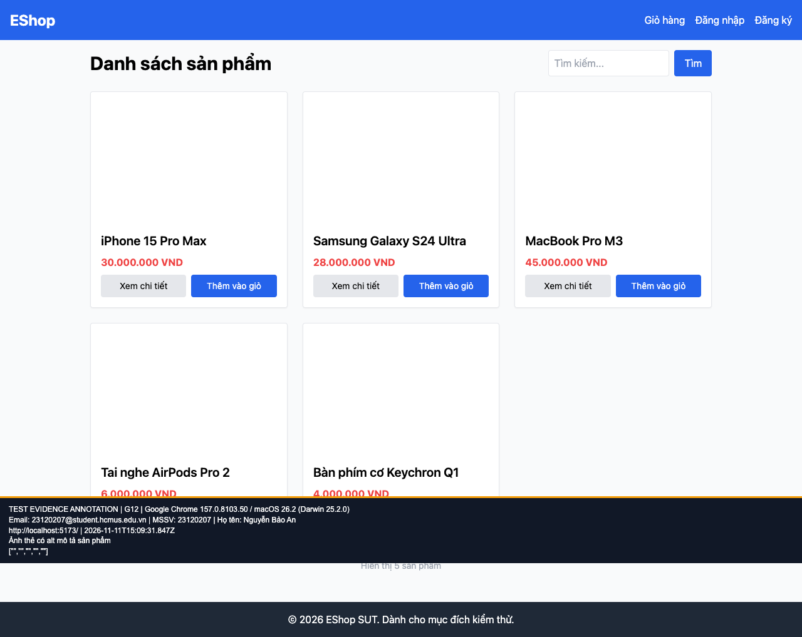

## B07: Ô tìm kiếm và số lượng thiếu nhãn truy cập được liên kết

Severity: **Major** (đề xuất, chưa có human review). Checklist: G13, G23.

Nguồn kỳ vọng: Heuristic: accessibility.

Môi trường: Firefox (Playwright build) 153.0 / macOS 26.2 (Darwin 25.2.0); Google Chrome 157.0.8103.50 / macOS 26.2 (Darwin 25.2.0); Safari 26.2 (Apple safaridriver) / macOS 26.2. SUT: `85af3ba875c88283615e22cb108f13e2fccaf0e9`.

Điều kiện: bản clone riêng, seed gốc, context mới, giỏ trống. Với case dữ liệu mạng, điều kiện giả lập được ghi trong bước.

Bước tái hiện: Mở Home và /product/1; kiểm tra labels, aria-label, aria-labelledby của input.

Kỳ vọng: Mỗi trường có tên truy cập bền vững.

Thực tế: Tìm kiếm chỉ có placeholder; label Số lượng không liên kết input. Đây là kiểm tra DOM, chưa thay thế thử screen reader thật.

GitHub Issue: https://github.com/NgBaoAnn/hw03-gui-usability/issues/7

Ảnh bằng chứng:

- chrome G13, 2026-11-11T15:09:32.325Z: [ảnh gốc](../evidence/gui/chrome/G13.png).
- chrome G23, 2026-11-11T15:09:37.328Z: [ảnh gốc](../evidence/gui/chrome/G23.png).
- firefox G13, 2026-11-11T15:09:36.898Z: [ảnh gốc](../evidence/gui/firefox/G13.png).
- firefox G23, 2026-11-11T15:09:47.928Z: [ảnh gốc](../evidence/gui/firefox/G23.png).
- safari G13, 2026-11-11T15:51:25.593399+00:00: [ảnh gốc](../evidence/gui/safari/G13.png).
- safari G23, 2026-11-11T15:51:31.095264+00:00: [ảnh gốc](../evidence/gui/safari/G23.png).

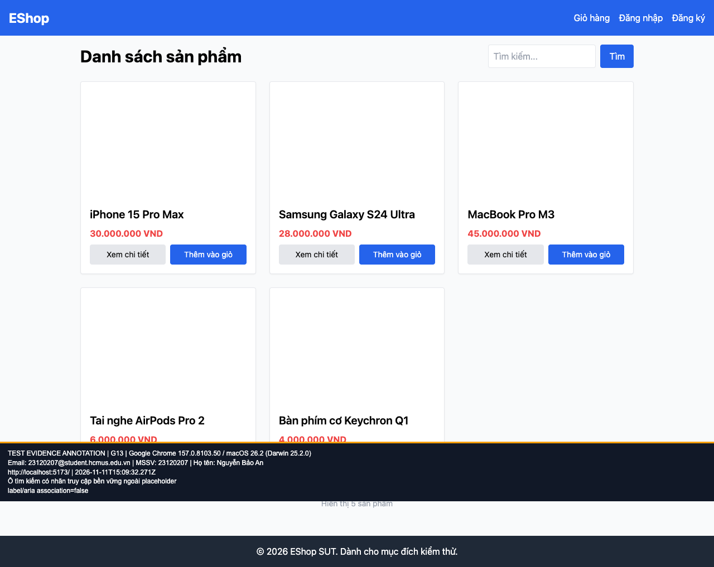

## B08: Ký tự & bị coi là dấu tách tham số trong từ khóa

Severity: **Major** (đề xuất, chưa có human review). Checklist: G16.

Nguồn kỳ vọng: FR-05.

Môi trường: Firefox (Playwright build) 153.0 / macOS 26.2 (Darwin 25.2.0); Google Chrome 157.0.8103.50 / macOS 26.2 (Darwin 25.2.0); Safari 26.2 (Apple safaridriver) / macOS 26.2. SUT: `85af3ba875c88283615e22cb108f13e2fccaf0e9`.

Điều kiện: bản clone riêng, seed gốc, context mới, giỏ trống. Với case dữ liệu mạng, điều kiện giả lập được ghi trong bước.

Bước tái hiện: Nhập iPhone&limit=1 ở Home, nhấn Enter.

Kỳ vọng: Tìm nguyên văn chuỗi; không sản phẩm nào khớp.

Thực tế: Vẫn trả iPhone vì query bị cắt tại &.

GitHub Issue: https://github.com/NgBaoAnn/hw03-gui-usability/issues/8

Ảnh bằng chứng:

- chrome G16, 2026-11-11T15:09:33.978Z: [ảnh gốc](../evidence/gui/chrome/G16.png).
- firefox G16, 2026-11-11T15:09:39.883Z: [ảnh gốc](../evidence/gui/firefox/G16.png).
- safari G16, 2026-11-11T15:51:27.468559+00:00: [ảnh gốc](../evidence/gui/safari/G16.png).

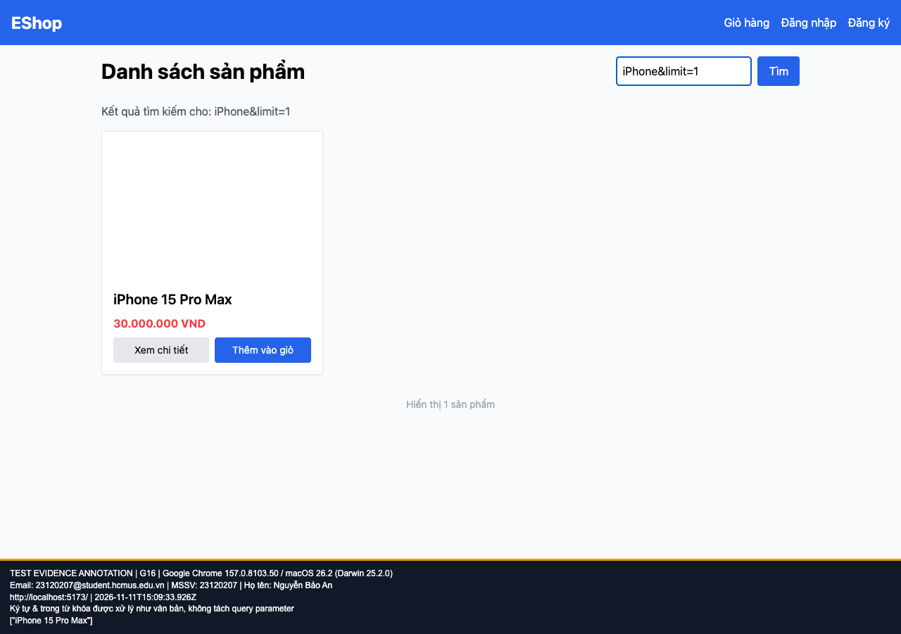

## B09: Số lượng không hợp lệ đi vào giỏ và sinh tổng âm hoặc NaN

Severity: **Major** (đề xuất, chưa có human review). Checklist: G19, G20, G21, G22.

Nguồn kỳ vọng: FR-06.

Môi trường: Firefox (Playwright build) 153.0 / macOS 26.2 (Darwin 25.2.0); Google Chrome 157.0.8103.50 / macOS 26.2 (Darwin 25.2.0); Safari 26.2 (Apple safaridriver) / macOS 26.2. SUT: `85af3ba875c88283615e22cb108f13e2fccaf0e9`.

Điều kiện: bản clone riêng, seed gốc, context mới, giỏ trống. Với case dữ liệu mạng, điều kiện giả lập được ghi trong bước.

Bước tái hiện: Mỗi lần mở mới /product/1; nhập 0, -1, 1.5 hoặc bỏ trống; bấm Thêm hai lần do B18; mở giỏ.

Kỳ vọng: Từ chối số lượng không phải số nguyên dương, hiển thị lỗi và không thay đổi giỏ.

Thực tế: Giỏ nhận 0, -1, làm tròn 1.5 thành 1, và ô trống thành NaN. Tổng âm hoặc NaN tương ứng.

GitHub Issue: https://github.com/NgBaoAnn/hw03-gui-usability/issues/9

Ảnh bằng chứng:

- chrome G19, 2026-11-11T15:09:34.997Z: [ảnh gốc](../evidence/gui/chrome/G19.png).
- chrome G20, 2026-11-11T15:09:35.847Z: [ảnh gốc](../evidence/gui/chrome/G20.png).
- chrome G21, 2026-11-11T15:09:36.371Z: [ảnh gốc](../evidence/gui/chrome/G21.png).
- chrome G22, 2026-11-11T15:09:36.847Z: [ảnh gốc](../evidence/gui/chrome/G22.png).
- firefox G19, 2026-11-11T15:09:41.971Z: [ảnh gốc](../evidence/gui/firefox/G19.png).
- firefox G20, 2026-11-11T15:09:42.634Z: [ảnh gốc](../evidence/gui/firefox/G20.png).
- firefox G21, 2026-11-11T15:09:45.842Z: [ảnh gốc](../evidence/gui/firefox/G21.png).
- firefox G22, 2026-11-11T15:09:46.530Z: [ảnh gốc](../evidence/gui/firefox/G22.png).
- safari G19, 2026-11-11T15:53:15.709264+00:00: [ảnh gốc](../evidence/gui/safari/G19.png).
- safari G20, 2026-11-11T15:53:16.503924+00:00: [ảnh gốc](../evidence/gui/safari/G20.png).
- safari G21, 2026-11-11T15:53:17.101448+00:00: [ảnh gốc](../evidence/gui/safari/G21.png).
- safari G22, 2026-11-11T15:53:17.791319+00:00: [ảnh gốc](../evidence/gui/safari/G22.png).

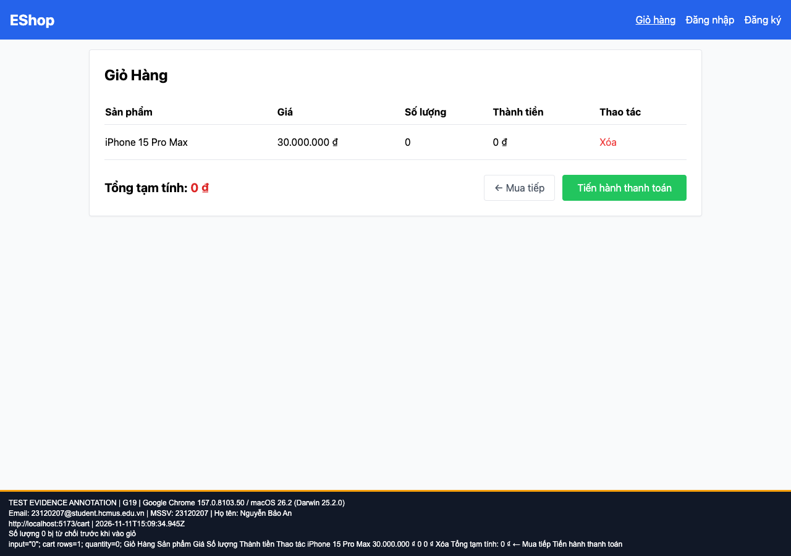

## B10: Từ khóa tìm kiếm bị render thành HTML

Severity: **Major** (đề xuất, chưa có human review). Checklist: G24.

Nguồn kỳ vọng: FR-05; SEC-04.

Môi trường: Firefox (Playwright build) 153.0 / macOS 26.2 (Darwin 25.2.0); Google Chrome 157.0.8103.50 / macOS 26.2 (Darwin 25.2.0); Safari 26.2 (Apple safaridriver) / macOS 26.2. SUT: `85af3ba875c88283615e22cb108f13e2fccaf0e9`.

Điều kiện: bản clone riêng, seed gốc, context mới, giỏ trống. Với case dữ liệu mạng, điều kiện giả lập được ghi trong bước.

Bước tái hiện: Nhập <b data-hw03-probe="1">HW03 probe</b> vào ô tìm kiếm. Không dùng payload script.

Kỳ vọng: Hiển thị nguyên văn HTML như văn bản an toàn.

Thực tế: DOM tạo phần tử b và hiển thị chữ đậm. Đã xác nhận HTML injection; chưa thực thi script hoặc khẳng định khai thác XSS sâu hơn.

GitHub Issue: https://github.com/NgBaoAnn/hw03-gui-usability/issues/10

Ảnh bằng chứng:

- chrome G24, 2026-11-11T15:09:37.714Z: [ảnh gốc](../evidence/gui/chrome/G24.png).
- firefox G24, 2026-11-11T15:09:48.673Z: [ảnh gốc](../evidence/gui/firefox/G24.png).
- safari G24, 2026-11-11T15:51:31.396671+00:00: [ảnh gốc](../evidence/gui/safari/G24.png).

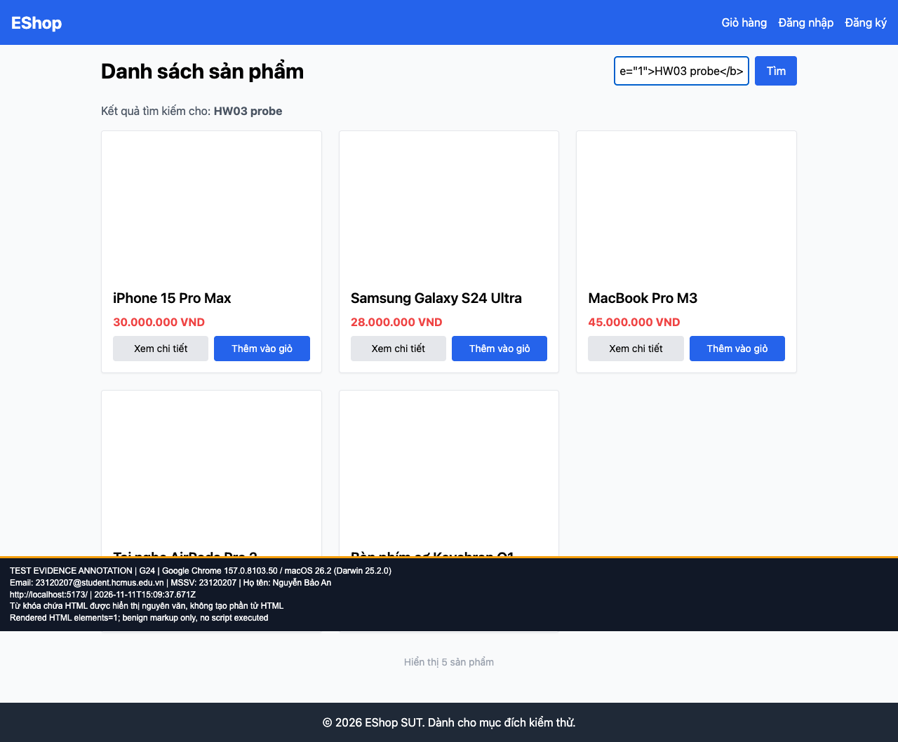

## B11: Browser Back làm mất từ khóa và tập kết quả

Severity: **Minor** (đề xuất, chưa có human review). Checklist: G29.

Nguồn kỳ vọng: Heuristic: continuity.

Môi trường: Firefox (Playwright build) 153.0 / macOS 26.2 (Darwin 25.2.0); Google Chrome 157.0.8103.50 / macOS 26.2 (Darwin 25.2.0); Safari 26.2 (Apple safaridriver) / macOS 26.2. SUT: `85af3ba875c88283615e22cb108f13e2fccaf0e9`.

Điều kiện: bản clone riêng, seed gốc, context mới, giỏ trống. Với case dữ liệu mạng, điều kiện giả lập được ghi trong bước.

Bước tái hiện: Tìm iPhone; mở chi tiết; dùng Browser Back.

Kỳ vọng: Giữ từ khóa và một kết quả theo heuristic duy trì ngữ cảnh.

Thực tế: Từ khóa rỗng và hiện lại 5 sản phẩm.

GitHub Issue: https://github.com/NgBaoAnn/hw03-gui-usability/issues/11

Ảnh bằng chứng:

- chrome G29, 2026-11-11T15:09:40.361Z: [ảnh gốc](../evidence/gui/chrome/G29.png).
- firefox G29, 2026-11-11T15:09:51.856Z: [ảnh gốc](../evidence/gui/firefox/G29.png).
- safari G29, 2026-11-11T15:59:28.651280+00:00: [ảnh gốc](../evidence/gui/safari/G29.png).

## B12: Trang chi tiết và giỏ thiếu breadcrumb

Severity: **Minor** (đề xuất, chưa có human review). Checklist: G30, G31.

Nguồn kỳ vọng: GUI §8.

Môi trường: Firefox (Playwright build) 153.0 / macOS 26.2 (Darwin 25.2.0); Google Chrome 157.0.8103.50 / macOS 26.2 (Darwin 25.2.0); Safari 26.2 (Apple safaridriver) / macOS 26.2. SUT: `85af3ba875c88283615e22cb108f13e2fccaf0e9`.

Điều kiện: bản clone riêng, seed gốc, context mới, giỏ trống. Với case dữ liệu mạng, điều kiện giả lập được ghi trong bước.

Bước tái hiện: Mở /product/1 và giỏ có hàng.

Kỳ vọng: Có breadcrumb theo GUI §8.

Thực tế: Không có vùng breadcrumb trên hai trang.

GitHub Issue: https://github.com/NgBaoAnn/hw03-gui-usability/issues/12

Ảnh bằng chứng:

- chrome G30, 2026-11-11T15:09:40.926Z: [ảnh gốc](../evidence/gui/chrome/G30.png).
- chrome G31, 2026-11-11T15:09:41.440Z: [ảnh gốc](../evidence/gui/chrome/G31.png).
- firefox G30, 2026-11-11T15:09:52.301Z: [ảnh gốc](../evidence/gui/firefox/G30.png).
- firefox G31, 2026-11-11T15:09:55.831Z: [ảnh gốc](../evidence/gui/firefox/G31.png).
- safari G30, 2026-11-11T15:51:44.600264+00:00: [ảnh gốc](../evidence/gui/safari/G30.png).
- safari G31, 2026-11-11T15:51:45.517264+00:00: [ảnh gốc](../evidence/gui/safari/G31.png).

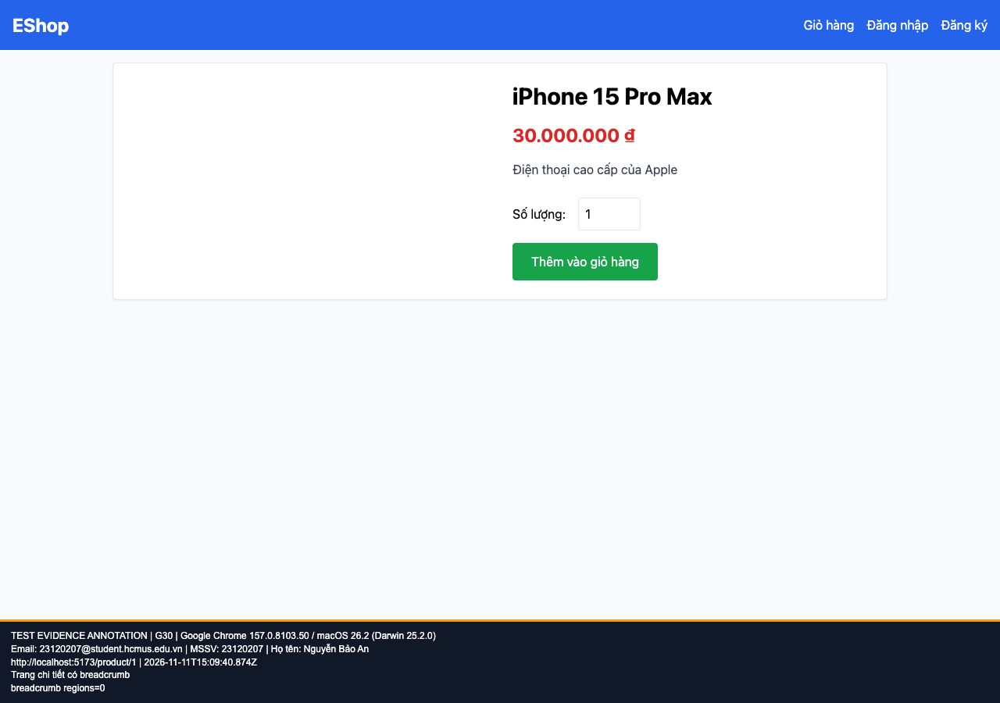

## B13: Navbar không highlight Giỏ hàng đang mở

Severity: **Minor** (đề xuất, chưa có human review). Checklist: G32.

Nguồn kỳ vọng: GUI §8.

Môi trường: Firefox (Playwright build) 153.0 / macOS 26.2 (Darwin 25.2.0); Google Chrome 157.0.8103.50 / macOS 26.2 (Darwin 25.2.0); Safari 26.2 (Apple safaridriver) / macOS 26.2. SUT: `85af3ba875c88283615e22cb108f13e2fccaf0e9`.

Điều kiện: bản clone riêng, seed gốc, context mới, giỏ trống. Với case dữ liệu mạng, điều kiện giả lập được ghi trong bước.

Bước tái hiện: Mở /cart, xem link Giỏ hàng.

Kỳ vọng: Có trạng thái được chọn và chỉ báo truy cập phù hợp.

Thực tế: Chỉ có hover:underline, không có highlight trang hiện tại.

GitHub Issue: https://github.com/NgBaoAnn/hw03-gui-usability/issues/13

Ảnh bằng chứng:

- chrome G32, 2026-11-11T15:09:41.791Z: [ảnh gốc](../evidence/gui/chrome/G32.png).
- firefox G32, 2026-11-11T15:09:56.097Z: [ảnh gốc](../evidence/gui/firefox/G32.png).
- safari G32, 2026-11-11T15:51:46.027308+00:00: [ảnh gốc](../evidence/gui/safari/G32.png).

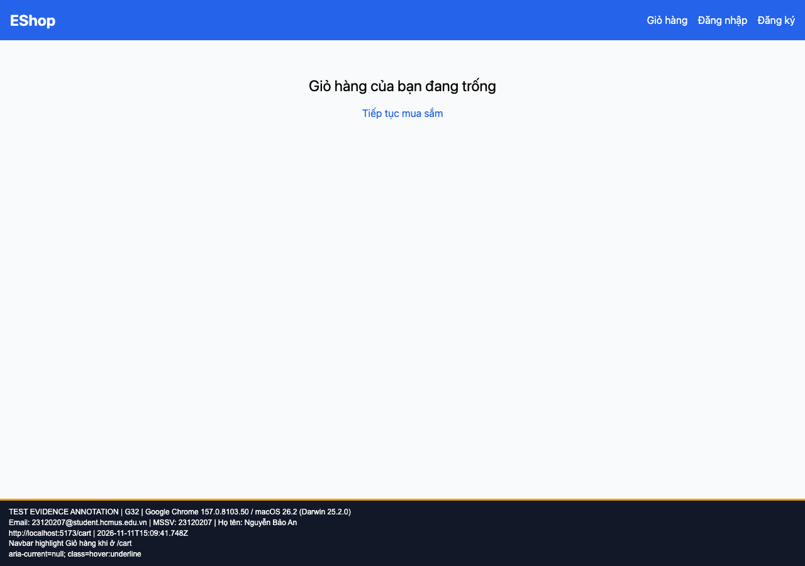

## B14: Thêm cùng sản phẩm hai lần tạo hai dòng giỏ

Severity: **Major** (đề xuất, chưa có human review). Checklist: G36.

Nguồn kỳ vọng: FR-07.

Môi trường: Firefox (Playwright build) 153.0 / macOS 26.2 (Darwin 25.2.0); Google Chrome 157.0.8103.50 / macOS 26.2 (Darwin 25.2.0); Safari 26.2 (Apple safaridriver) / macOS 26.2. SUT: `85af3ba875c88283615e22cb108f13e2fccaf0e9`.

Điều kiện: bản clone riêng, seed gốc, context mới, giỏ trống. Với case dữ liệu mạng, điều kiện giả lập được ghi trong bước.

Bước tái hiện: Ở Home bấm Thêm vào giỏ hai lần trên cùng thẻ; mở giỏ.

Kỳ vọng: Một dòng có số lượng 2.

Thực tế: Hai dòng cùng sản phẩm, mỗi dòng số lượng 1.

GitHub Issue: https://github.com/NgBaoAnn/hw03-gui-usability/issues/14

Ảnh bằng chứng:

- chrome G36, 2026-11-11T15:09:44.997Z: [ảnh gốc](../evidence/gui/chrome/G36.png).
- firefox G36, 2026-11-11T15:09:58.557Z: [ảnh gốc](../evidence/gui/firefox/G36.png).
- safari G36, 2026-11-11T15:51:48.068372+00:00: [ảnh gốc](../evidence/gui/safari/G36.png).

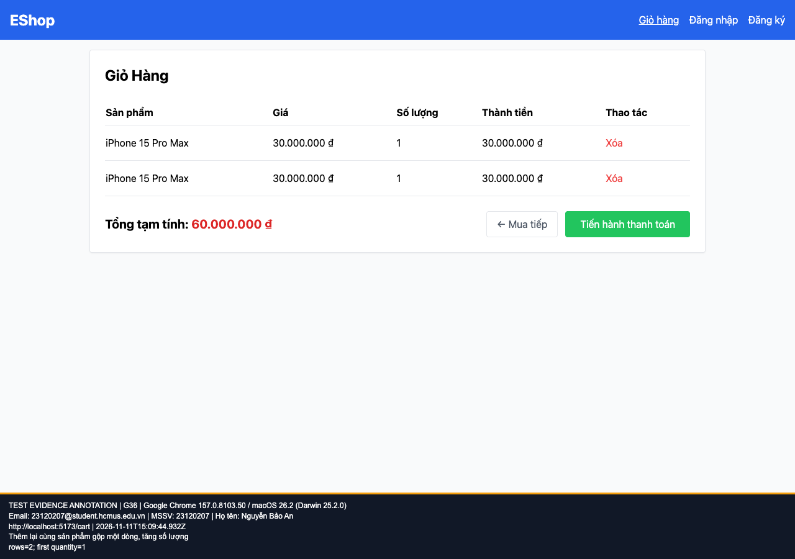

## B15: Danh sách thiếu loading khi đang chờ API

Severity: **Minor** (đề xuất, chưa có human review). Checklist: G37.

Nguồn kỳ vọng: FR-05.

Môi trường: Firefox (Playwright build) 153.0 / macOS 26.2 (Darwin 25.2.0); Google Chrome 157.0.8103.50 / macOS 26.2 (Darwin 25.2.0); Safari 26.2 (Apple safaridriver) / macOS 26.2. SUT: `85af3ba875c88283615e22cb108f13e2fccaf0e9`.

Điều kiện: bản clone riêng, seed gốc, context mới, giỏ trống. Với case dữ liệu mạng, điều kiện giả lập được ghi trong bước.

Bước tái hiện: Giả lập trễ GET /api/products? 1600ms: Chrome/Firefox dùng Playwright route, Safari dùng XHR redirect tới fixture localhost; mở Home.

Kỳ vọng: Có thông báo/loading indicator khi chờ.

Thực tế: Chỉ có tiêu đề và form tìm kiếm trong thời gian chờ. Điều kiện mạng được mô phỏng có kiểm soát.

GitHub Issue: https://github.com/NgBaoAnn/hw03-gui-usability/issues/15

Ảnh bằng chứng:

- chrome G37, 2026-11-11T15:09:45.301Z: [ảnh gốc](../evidence/gui/chrome/G37.png).
- firefox G37, 2026-11-11T15:09:58.816Z: [ảnh gốc](../evidence/gui/firefox/G37.png).
- safari G37, 2026-11-11T15:51:48.472524+00:00: [ảnh gốc](../evidence/gui/safari/G37.png).

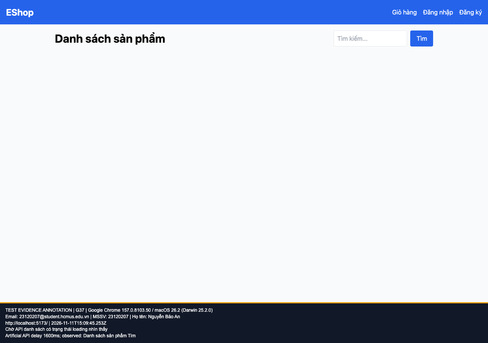

## B16: Không có kết quả tìm kiếm nhưng thiếu empty-state message

Severity: **Minor** (đề xuất, chưa có human review). Checklist: G38.

Nguồn kỳ vọng: FR-05; GUI §8.

Môi trường: Firefox (Playwright build) 153.0 / macOS 26.2 (Darwin 25.2.0); Google Chrome 157.0.8103.50 / macOS 26.2 (Darwin 25.2.0); Safari 26.2 (Apple safaridriver) / macOS 26.2. SUT: `85af3ba875c88283615e22cb108f13e2fccaf0e9`.

Điều kiện: bản clone riêng, seed gốc, context mới, giỏ trống. Với case dữ liệu mạng, điều kiện giả lập được ghi trong bước.

Bước tái hiện: Tìm HW03-no-such-product-731.

Kỳ vọng: Thông báo thân thiện rằng không có kết quả.

Thực tế: Chỉ hiện dòng từ khóa, không có thông báo trạng thái rỗng.

GitHub Issue: https://github.com/NgBaoAnn/hw03-gui-usability/issues/16

Ảnh bằng chứng:

- chrome G38, 2026-11-11T15:09:45.810Z: [ảnh gốc](../evidence/gui/chrome/G38.png).
- firefox G38, 2026-11-11T15:09:59.244Z: [ảnh gốc](../evidence/gui/firefox/G38.png).
- safari G38, 2026-11-11T15:51:48.736955+00:00: [ảnh gốc](../evidence/gui/safari/G38.png).

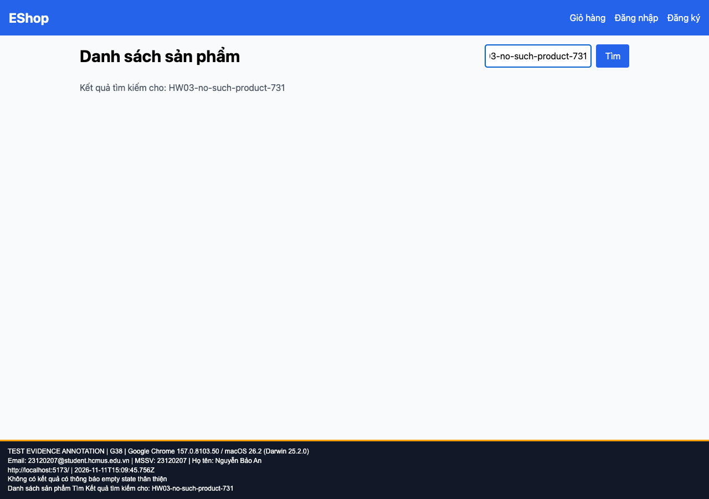

## B17: Thêm từ thẻ không có phản hồi và giỏ không có badge

Severity: **Major** (đề xuất, chưa có human review). Checklist: G39, G42.

Nguồn kỳ vọng: FR-06; GUI §8; GUI §8.

Môi trường: Firefox (Playwright build) 153.0 / macOS 26.2 (Darwin 25.2.0); Google Chrome 157.0.8103.50 / macOS 26.2 (Darwin 25.2.0); Safari 26.2 (Apple safaridriver) / macOS 26.2. SUT: `85af3ba875c88283615e22cb108f13e2fccaf0e9`.

Điều kiện: bản clone riêng, seed gốc, context mới, giỏ trống. Với case dữ liệu mạng, điều kiện giả lập được ghi trong bước.

Bước tái hiện: Từ Home bấm Thêm vào giỏ một lần, quan sát màn hình và navbar.

Kỳ vọng: Toast/badge thông báo thêm thành công; link giỏ có số lượng.

Thực tế: Không có toast, vùng thông báo hoặc badge. Mở giỏ mới thấy sản phẩm đã được thêm.

GitHub Issue: https://github.com/NgBaoAnn/hw03-gui-usability/issues/17

Ảnh bằng chứng:

- chrome G39, 2026-11-11T15:09:46.187Z: [ảnh gốc](../evidence/gui/chrome/G39.png).
- chrome G42, 2026-11-11T15:09:48.731Z: [ảnh gốc](../evidence/gui/chrome/G42.png).
- firefox G39, 2026-11-11T15:09:59.924Z: [ảnh gốc](../evidence/gui/firefox/G39.png).
- firefox G42, 2026-11-11T15:10:03.684Z: [ảnh gốc](../evidence/gui/firefox/G42.png).
- safari G39, 2026-11-11T15:51:50.066825+00:00: [ảnh gốc](../evidence/gui/safari/G39.png).
- safari G42, 2026-11-11T15:51:51.178332+00:00: [ảnh gốc](../evidence/gui/safari/G42.png).

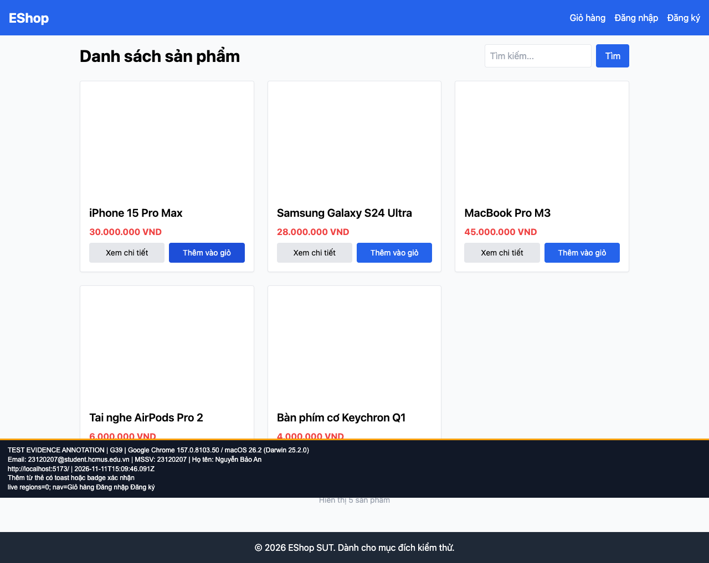

## B18: Lần bấm Thêm vào giỏ đầu tiên ở chi tiết không làm gì

Severity: **Major** (đề xuất, chưa có human review). Checklist: G40.

Nguồn kỳ vọng: FR-06.

Môi trường: Firefox (Playwright build) 153.0 / macOS 26.2 (Darwin 25.2.0); Google Chrome 157.0.8103.50 / macOS 26.2 (Darwin 25.2.0); Safari 26.2 (Apple safaridriver) / macOS 26.2. SUT: `85af3ba875c88283615e22cb108f13e2fccaf0e9`.

Điều kiện: bản clone riêng, seed gốc, context mới, giỏ trống. Với case dữ liệu mạng, điều kiện giả lập được ghi trong bước.

Bước tái hiện: Mở mới /product/1; bấm Thêm vào giỏ hàng đúng một lần; mở Giỏ hàng.

Kỳ vọng: Giỏ có một sản phẩm ngay sau một lần bấm.

Thực tế: Giỏ trống. Bấm lần hai mới thêm và hiện Đã thêm.

GitHub Issue: https://github.com/NgBaoAnn/hw03-gui-usability/issues/18

Ảnh bằng chứng:

- chrome G40, 2026-11-11T15:09:46.649Z: [ảnh gốc](../evidence/gui/chrome/G40.png).
- firefox G40, 2026-11-11T15:10:00.442Z: [ảnh gốc](../evidence/gui/firefox/G40.png).
- safari G40, 2026-11-11T15:51:50.532846+00:00: [ảnh gốc](../evidence/gui/safari/G40.png).

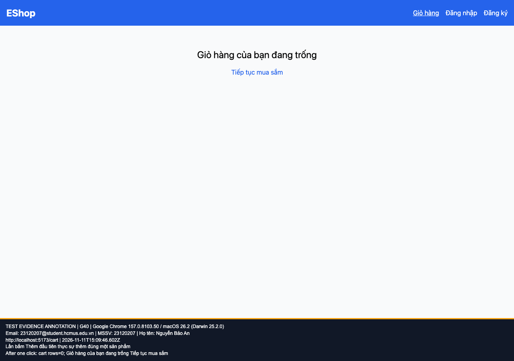

## B19: Xóa sản phẩm khỏi giỏ ngay lập tức không có xác nhận

Severity: **Major** (đề xuất, chưa có human review). Checklist: G43.

Nguồn kỳ vọng: FR-07; GUI §8.

Môi trường: Firefox (Playwright build) 153.0 / macOS 26.2 (Darwin 25.2.0); Google Chrome 157.0.8103.50 / macOS 26.2 (Darwin 25.2.0); Safari 26.2 (Apple safaridriver) / macOS 26.2. SUT: `85af3ba875c88283615e22cb108f13e2fccaf0e9`.

Điều kiện: bản clone riêng, seed gốc, context mới, giỏ trống. Với case dữ liệu mạng, điều kiện giả lập được ghi trong bước.

Bước tái hiện: Từ Home thêm sản phẩm; mở giỏ; bấm Xóa.

Kỳ vọng: Hiện dialog xác nhận trước khi xóa.

Thực tế: Không có native dialog hay role=dialog; sản phẩm mất ngay.

GitHub Issue: https://github.com/NgBaoAnn/hw03-gui-usability/issues/19

Ảnh bằng chứng:

- chrome G43, 2026-11-11T15:09:49.468Z: [ảnh gốc](../evidence/gui/chrome/G43.png).
- firefox G43, 2026-11-11T15:10:04.116Z: [ảnh gốc](../evidence/gui/firefox/G43.png).
- safari G43, 2026-11-11T15:51:51.620481+00:00: [ảnh gốc](../evidence/gui/safari/G43.png).

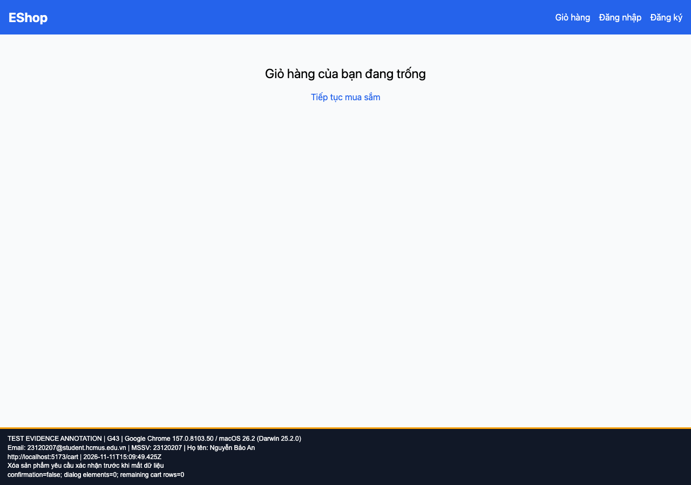

## B20: Giỏ trống thiếu hình minh họa hoặc icon

Severity: **Minor** (đề xuất, chưa có human review). Checklist: G44.

Nguồn kỳ vọng: FR-07; GUI §8.

Môi trường: Firefox (Playwright build) 153.0 / macOS 26.2 (Darwin 25.2.0); Google Chrome 157.0.8103.50 / macOS 26.2 (Darwin 25.2.0); Safari 26.2 (Apple safaridriver) / macOS 26.2. SUT: `85af3ba875c88283615e22cb108f13e2fccaf0e9`.

Điều kiện: bản clone riêng, seed gốc, context mới, giỏ trống. Với case dữ liệu mạng, điều kiện giả lập được ghi trong bước.

Bước tái hiện: Mở /cart trong context mới.

Kỳ vọng: Có thông báo kèm hình/icon theo FR-07.

Thực tế: Có câu thông báo nhưng không có hình/icon.

GitHub Issue: https://github.com/NgBaoAnn/hw03-gui-usability/issues/20

Ảnh bằng chứng:

- chrome G44, 2026-11-11T15:09:49.799Z: [ảnh gốc](../evidence/gui/chrome/G44.png).
- firefox G44, 2026-11-11T15:10:04.345Z: [ảnh gốc](../evidence/gui/firefox/G44.png).
- safari G44, 2026-11-11T15:51:52.151463+00:00: [ảnh gốc](../evidence/gui/safari/G44.png).

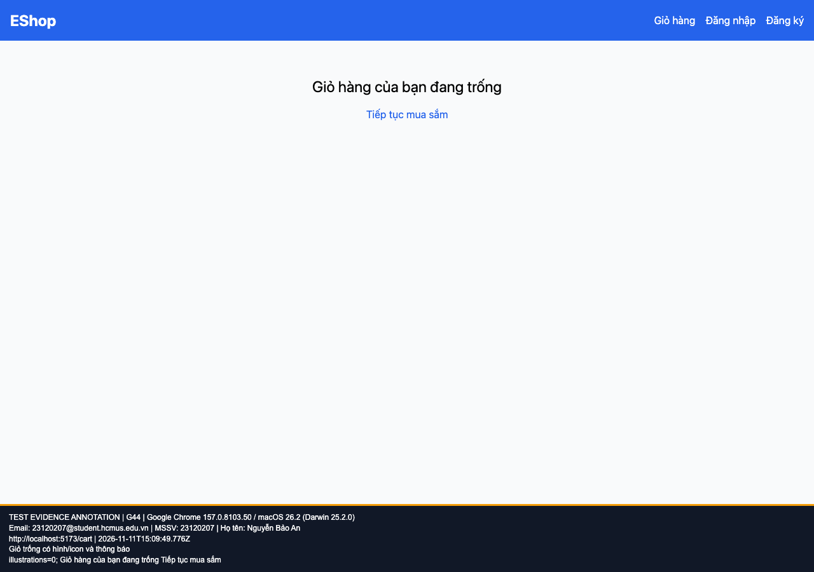

## B21: Giỏ dùng nhãn Tổng tạm tính thay cho Tổng cộng

Severity: **Minor** (đề xuất, chưa có human review). Checklist: G45.

Nguồn kỳ vọng: FR-07.

Môi trường: Firefox (Playwright build) 153.0 / macOS 26.2 (Darwin 25.2.0); Google Chrome 157.0.8103.50 / macOS 26.2 (Darwin 25.2.0); Safari 26.2 (Apple safaridriver) / macOS 26.2. SUT: `85af3ba875c88283615e22cb108f13e2fccaf0e9`.

Điều kiện: bản clone riêng, seed gốc, context mới, giỏ trống. Với case dữ liệu mạng, điều kiện giả lập được ghi trong bước.

Bước tái hiện: Thêm sản phẩm từ Home rồi mở giỏ.

Kỳ vọng: Nhãn Tổng cộng theo FR-07.

Thực tế: Hiển thị Tổng tạm tính.

GitHub Issue: https://github.com/NgBaoAnn/hw03-gui-usability/issues/21

Ảnh bằng chứng:

- chrome G45, 2026-11-11T15:09:50.374Z: [ảnh gốc](../evidence/gui/chrome/G45.png).
- firefox G45, 2026-11-11T15:10:04.706Z: [ảnh gốc](../evidence/gui/firefox/G45.png).
- safari G45, 2026-11-11T15:51:52.553146+00:00: [ảnh gốc](../evidence/gui/safari/G45.png).

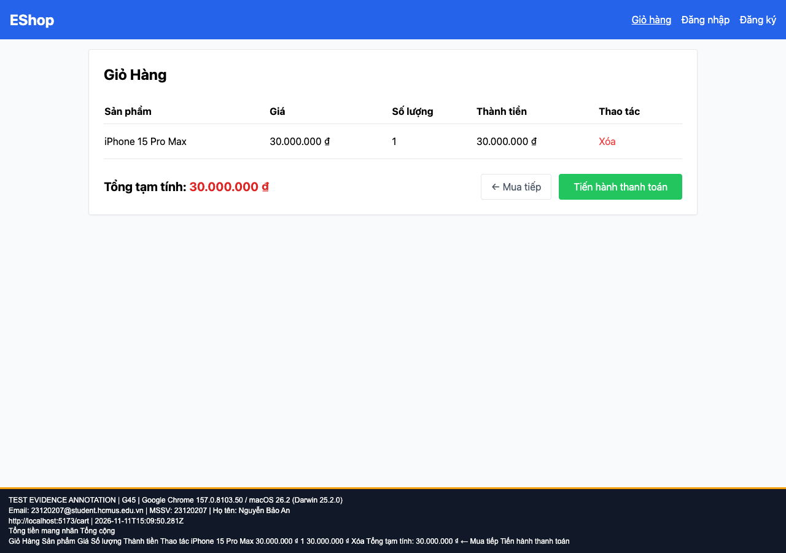

## B22: Lỗi API danh sách/chi tiết không có thông báo khôi phục

Severity: **Major** (đề xuất, chưa có human review). Checklist: G47, G48.

Nguồn kỳ vọng: Heuristic: error recovery.

Môi trường: Firefox (Playwright build) 153.0 / macOS 26.2 (Darwin 25.2.0); Google Chrome 157.0.8103.50 / macOS 26.2 (Darwin 25.2.0); Safari 26.2 (Apple safaridriver) / macOS 26.2. SUT: `85af3ba875c88283615e22cb108f13e2fccaf0e9`.

Điều kiện: bản clone riêng, seed gốc, context mới, giỏ trống. Với case dữ liệu mạng, điều kiện giả lập được ghi trong bước.

Bước tái hiện: Giả lập HTTP 503 JSON cho GET products hoặc products/1; mở trang tương ứng.

Kỳ vọng: Thông báo lỗi phù hợp, không chờ vô hạn và có cách tiếp tục.

Thực tế: Home trống dưới form; chi tiết kẹt Đang tải. Điều kiện lỗi mạng được mô phỏng có kiểm soát.

GitHub Issue: https://github.com/NgBaoAnn/hw03-gui-usability/issues/22

Ảnh bằng chứng:

- chrome G47, 2026-11-11T15:09:53.306Z: [ảnh gốc](../evidence/gui/chrome/G47.png).
- chrome G48, 2026-11-11T15:09:54.291Z: [ảnh gốc](../evidence/gui/chrome/G48.png).
- firefox G47, 2026-11-11T15:10:06.901Z: [ảnh gốc](../evidence/gui/firefox/G47.png).
- firefox G48, 2026-11-11T15:10:07.866Z: [ảnh gốc](../evidence/gui/firefox/G48.png).
- safari G47, 2026-11-11T15:51:55.055625+00:00: [ảnh gốc](../evidence/gui/safari/G47.png).
- safari G48, 2026-11-11T15:51:56.239739+00:00: [ảnh gốc](../evidence/gui/safari/G48.png).

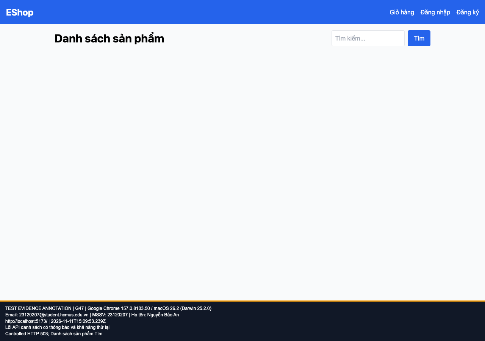

## B23: Firefox tràn ngang 8px ở viewport 390px

Severity: **Minor** (đề xuất, chưa có human review). Checklist: G09.

Nguồn kỳ vọng: Heuristic: responsive.

Môi trường: Firefox (Playwright build) 153.0 / macOS 26.2 (Darwin 25.2.0). SUT: `85af3ba875c88283615e22cb108f13e2fccaf0e9`.

Điều kiện: bản clone riêng, seed gốc, context mới, giỏ trống. Với case dữ liệu mạng, điều kiện giả lập được ghi trong bước.

Bước tái hiện: Dùng Firefox Playwright build, viewport 390×844, mở Home.

Kỳ vọng: documentElement.scrollWidth <= innerWidth.

Thực tế: Firefox scrollWidth=398 khi innerWidth=390. Chrome cùng kích thước là 390. Đây là viewport mobile giả lập trên desktop, không phải điện thoại thật.

GitHub Issue: https://github.com/NgBaoAnn/hw03-gui-usability/issues/23

Ảnh bằng chứng:

- firefox G09, 2026-11-11T15:09:33.455Z: [ảnh gốc](../evidence/gui/firefox/G09.png).

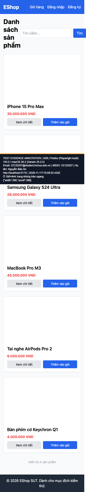
