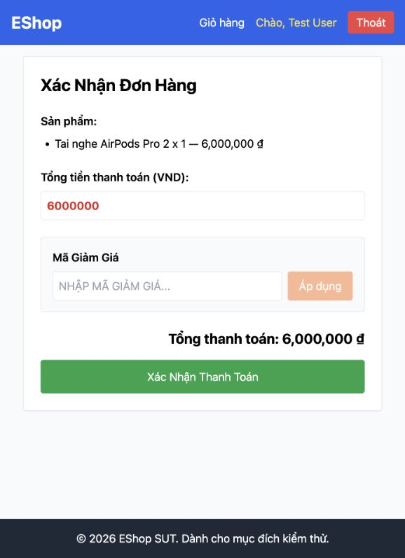

# D01: Tổng checkout cho chỉnh sửa trực tiếp

Severity: Major (AI đề xuất). Nguồn: EShop README FR-08, revision `85af3ba875c88283615e22cb108f13e2fccaf0e9`.

Quan sát demo: 16/11/2026, 01:04–01:08 +07, macOS 26.2, IAB browser hiển thị, engine/version không được công cụ cung cấp. SUT http://localhost:5173 ; API http://localhost:3000 . Không tính là lượt Chrome/Firefox/Safari của Task 3.

Bước tái hiện: Đăng nhập tài khoản demo, thêm AirPods Pro 2 x1, mở /checkout, kiểm tra ô tổng.

Kỳ vọng: Tổng được tính từ giỏ và không được chỉnh trực tiếp.

Thực tế: Ô tổng là input type=number có onChange cập nhật editableTotal; UI cho sửa. Chỉ kết luận sai yêu cầu giao diện; không khẳng định backend chấp nhận thanh toán thiếu tiền vì demo chưa sửa tổng rồi gửi đơn.

Thông tin người nộp: Nguyễn Bảo An – 23120207 – 23120207@student.hcmus.edu.vn. Ảnh demo giữ nguyên, định danh ghi tại báo cáo nguồn; ảnh U02 đã có overlay. Không tạo screenshot thay cho phiên người tham gia.

GitHub Issue: https://github.com/NgBaoAnn/hw03-gui-usability/issues/31

