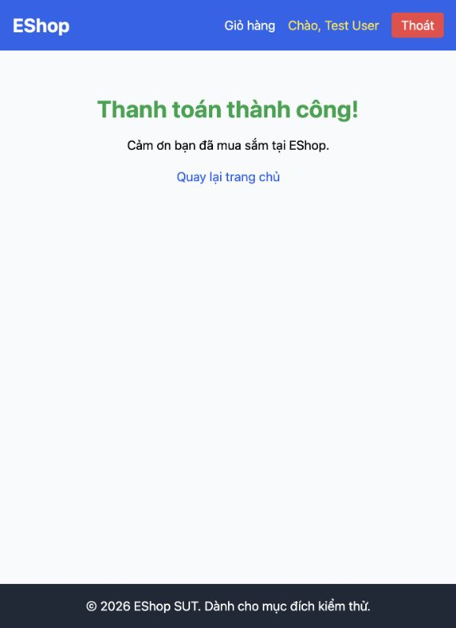
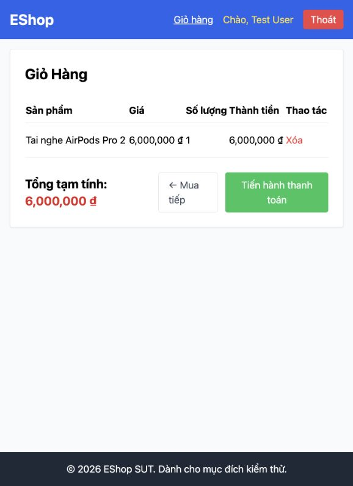

# D02: Giỏ còn hàng sau thanh toán thành công

Severity: Major (AI đề xuất). Nguồn: EShop README FR-08, revision `85af3ba875c88283615e22cb108f13e2fccaf0e9`.

Quan sát demo: 16/11/2026, 01:04–01:08 +07, macOS 26.2, IAB browser hiển thị, engine/version không được công cụ cung cấp. SUT http://localhost:5173 ; API http://localhost:3000 . Không tính là lượt Chrome/Firefox/Safari của Task 3.

Bước tái hiện: Đăng nhập, thêm AirPods Pro 2 x1, checkout với tổng 6.000.000 ₫; thấy thành công, kiểm tra lịch sử đơn rồi mở lại giỏ trong cùng phiên.

Kỳ vọng: Đơn tạo thành công thì giỏ được xóa.

Thực tế: Đơn #9 được ghi nhận Chờ xác nhận nhưng giỏ vẫn có AirPods Pro 2 x1. Code Checkout gọi setSuccess(true) mà không gọi clearCart; đây là hậu kiểm cùng phiên, không phải khôi phục từ dữ liệu giả lập.

Thông tin người nộp: Nguyễn Bảo An – 23120207 – 23120207@student.hcmus.edu.vn. Ảnh demo giữ nguyên, định danh ghi tại báo cáo nguồn; ảnh U02 đã có overlay. Không tạo screenshot thay cho phiên người tham gia.

GitHub Issue: https://github.com/NgBaoAnn/hw03-gui-usability/issues/32

