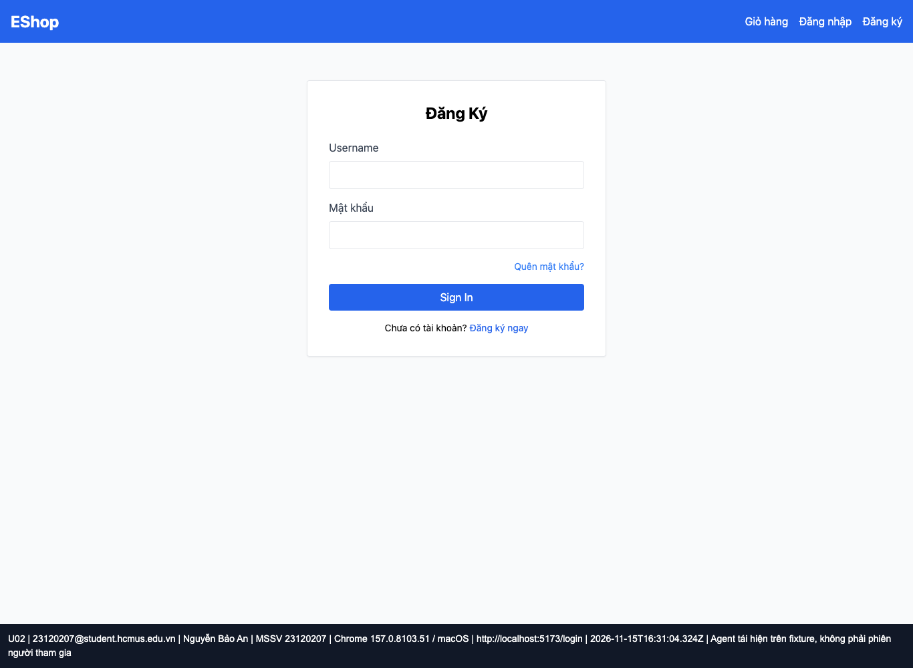

# D03: Form đăng nhập trộn nhãn tiếng Anh

Severity: Minor (AI đề xuất). Nguồn: EShop README FR-21, revision `85af3ba875c88283615e22cb108f13e2fccaf0e9`.

Quan sát demo: 16/11/2026, 01:04–01:08 +07, macOS 26.2, IAB browser hiển thị, engine/version không được công cụ cung cấp. SUT http://localhost:5173 ; API http://localhost:3000 . Không tính là lượt Chrome/Firefox/Safari của Task 3.

Bước tái hiện: Mở /login, quan sát nhãn username và nút submit.

Kỳ vọng: Giao diện dùng tiếng Việt, trừ thuật ngữ kỹ thuật chuẩn.

Thực tế: Nhãn Username và nút Sign In còn tiếng Anh. Demo ghi nhận trong AX tree/transcript; ảnh U02.png do agent tái hiện ngày 15/11 cũng thể hiện cùng nhãn (không phải ảnh lấy từ video). Tiêu đề Đăng Ký sai trên trang đăng nhập đã tách ở U02, tránh đếm trùng nguyên nhân.

Thông tin người nộp: Nguyễn Bảo An – 23120207 – 23120207@student.hcmus.edu.vn. Ảnh demo giữ nguyên, định danh ghi tại báo cáo nguồn; ảnh U02 đã có overlay. Không tạo screenshot thay cho phiên người tham gia.

GitHub Issue: https://github.com/NgBaoAnn/hw03-gui-usability/issues/33

