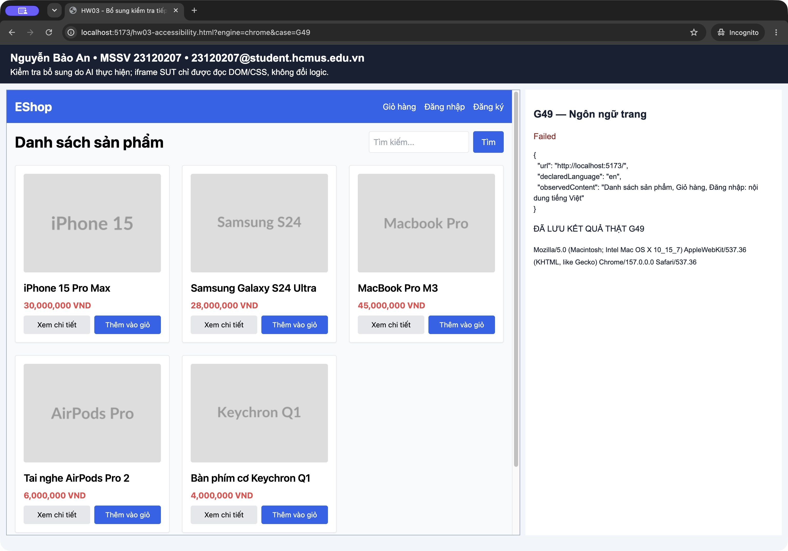
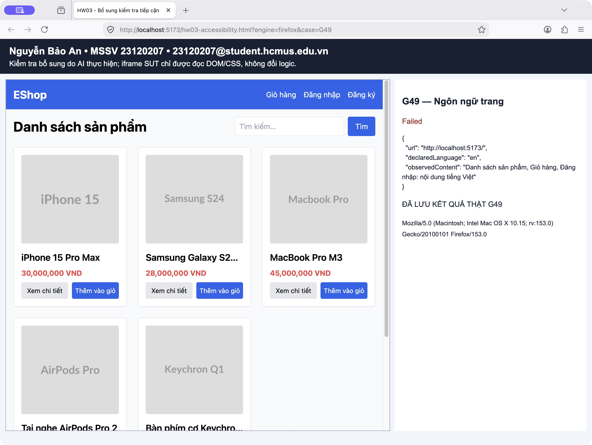
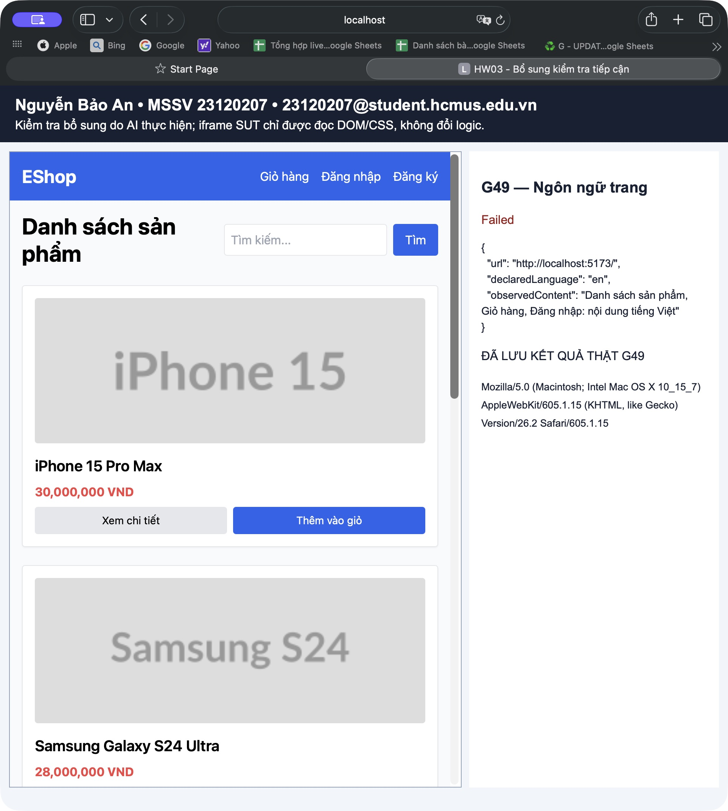

# B24: Trang tiếng Việt khai báo ngôn ngữ mặc định en

Severity: **Major** (AI đề xuất). Checklist bổ sung: G49. Tác giả bổ sung: Codex theo yêu cầu sinh viên; chưa gán thành mục sinh viên tự phát hiện.

Nguồn kỳ vọng: WCAG accessibility heuristic, chưa có tuyên bố SUT cam kết đạt WCAG. https://www.w3.org/WAI/WCAG22/Understanding/language-of-page.html

Tiền điều kiện: SUT revision `85af3ba875c88283615e22cb108f13e2fccaf0e9`; browser native Chrome, Firefox Playwright build, Safari 26.2 trên macOS 26.2. Bằng chứng có UA; phiên bản OS trong UA được browser rút gọn, OS thực lấy từ sw_vers trong JSON.

Bước: Mở Home, đọc document.documentElement.lang; đối chiếu nội dung tiếng Việt.

Kỳ vọng: Ngôn ngữ mặc định vi hoặc vi-VN tương ứng nội dung.

Thực tế: lang=en trên cả ba browser. Chưa kiểm tra phát âm bằng screen reader thật.

Phương pháp: mở trang đo cùng origin qua CUA; iframe SUT chỉ được đọc DOM/CSS. Không sửa style/logic SUT, không gọi screen reader hay giả lập người tham gia. Màu CSS chuyển sang sRGB bằng canvas, lấy màu nền tổng hợp và tính độ sáng tương đối. Self-check đen/trắng=21, cùng màu=1; Python đối chiếu độc lập cả sáu phép đo tương phản. Đây là lỗi theo heuristic tiếp cận, không tự suy ra tác động thực nghiệm ở người dùng.

GitHub Issue: https://github.com/NgBaoAnn/hw03-gui-usability/issues/29

