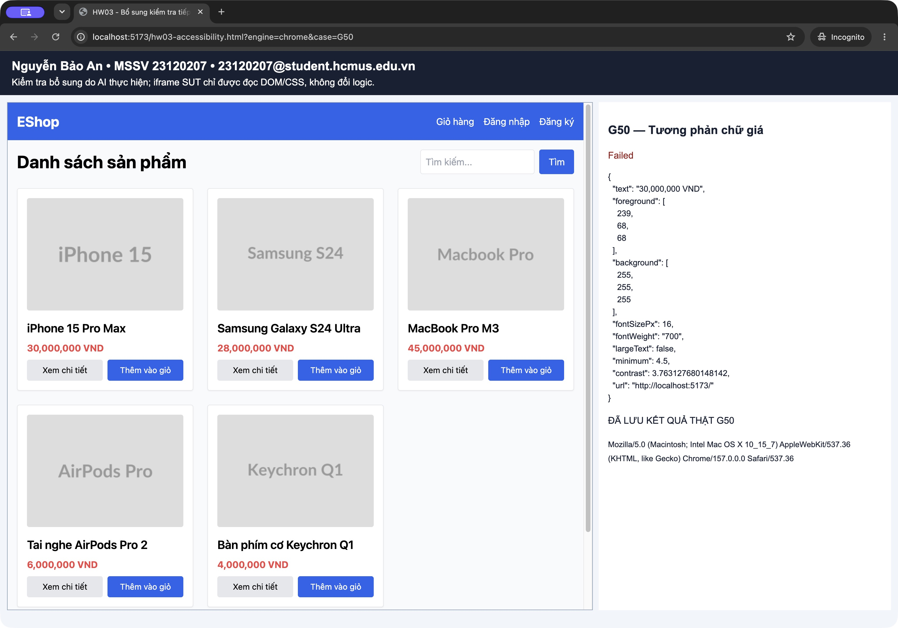
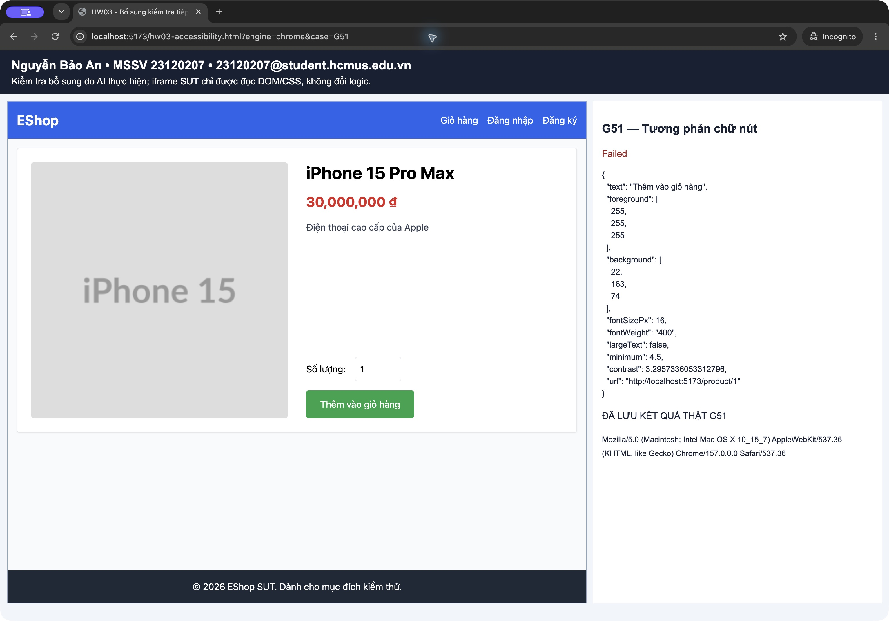
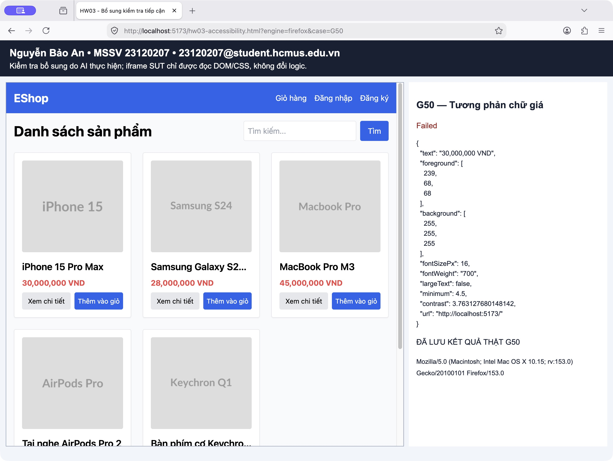
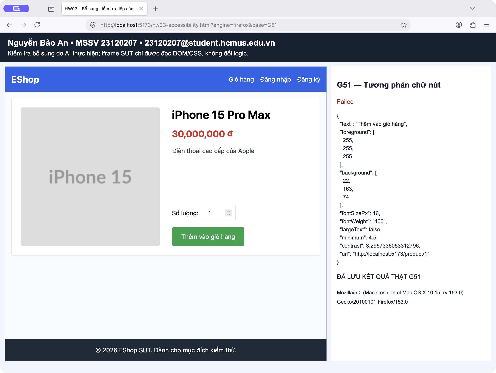
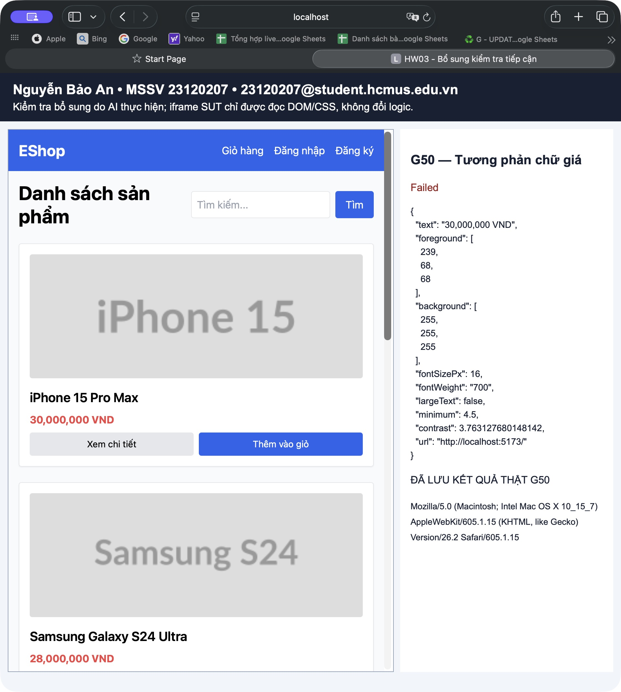
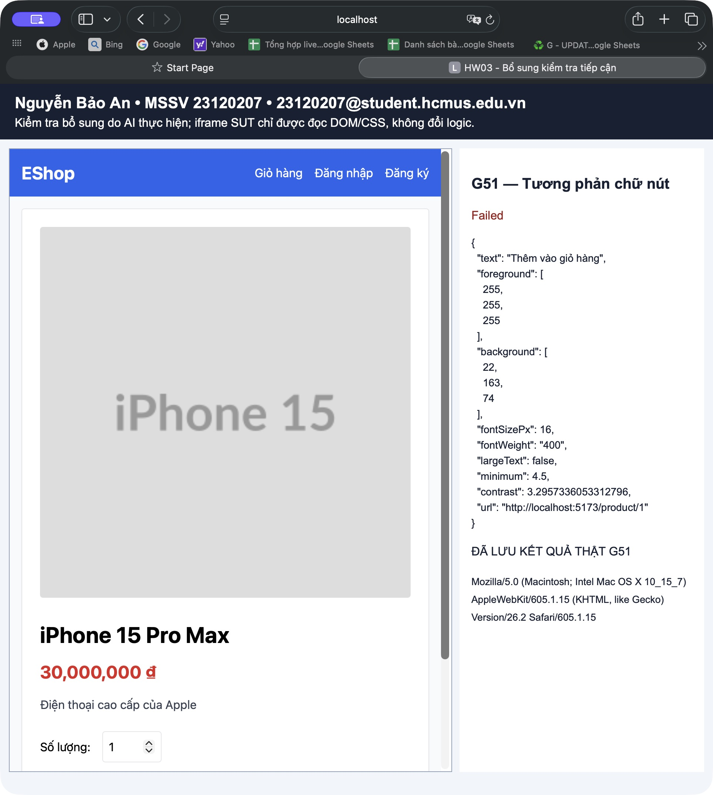

# B25: Chữ giá và chữ nút thêm giỏ thiếu tương phản

Severity: **Major** (AI đề xuất). Checklist bổ sung: G50, G51. Tác giả bổ sung: Codex theo yêu cầu sinh viên; chưa gán thành mục sinh viên tự phát hiện.

Nguồn kỳ vọng: WCAG accessibility heuristic, chưa có tuyên bố SUT cam kết đạt WCAG. https://www.w3.org/WAI/WCAG22/Understanding/contrast-minimum.html

Tiền điều kiện: SUT revision `85af3ba875c88283615e22cb108f13e2fccaf0e9`; browser native Chrome, Firefox Playwright build, Safari 26.2 trên macOS 26.2. Bằng chứng có UA; phiên bản OS trong UA được browser rút gọn, OS thực lấy từ sw_vers trong JSON.

Bước: Đọc computed color/background/font size/weight trên chữ giá Home và nút thêm giỏ Detail ở trạng thái mặc định.

Kỳ vọng: Chữ 16px: tương phản tối thiểu 4.5:1. Không làm tròn tỷ lệ trước khi so ngưỡng.

Thực tế: Home: rgb(239,68,68) trên trắng, 16px/700, tỷ lệ 3.763127680148142. Nút: trắng trên rgb(22,163,74), 16px/400, tỷ lệ 3.2957336053312796. Cùng kết quả trên ba browser.

Phương pháp: mở trang đo cùng origin qua CUA; iframe SUT chỉ được đọc DOM/CSS. Không sửa style/logic SUT, không gọi screen reader hay giả lập người tham gia. Màu CSS chuyển sang sRGB bằng canvas, lấy màu nền tổng hợp và tính độ sáng tương đối. Self-check đen/trắng=21, cùng màu=1; Python đối chiếu độc lập cả sáu phép đo tương phản. Đây là lỗi theo heuristic tiếp cận, không tự suy ra tác động thực nghiệm ở người dùng.

GitHub Issue: https://github.com/NgBaoAnn/hw03-gui-usability/issues/30

