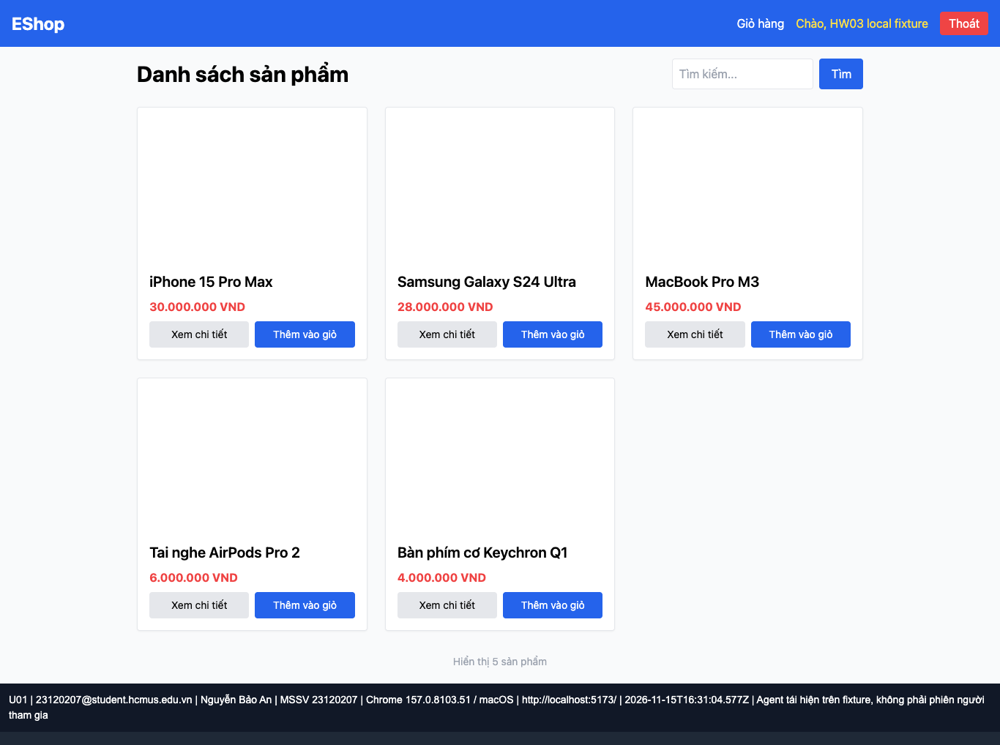
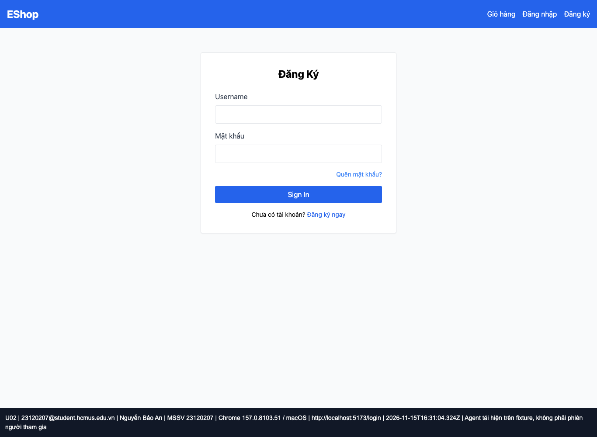
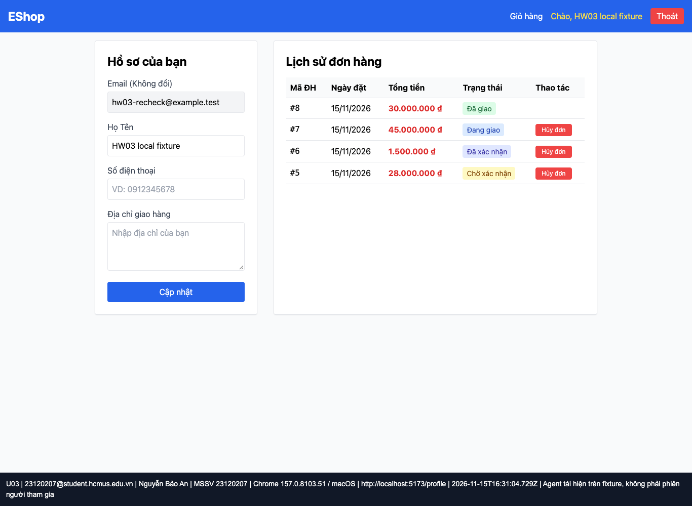
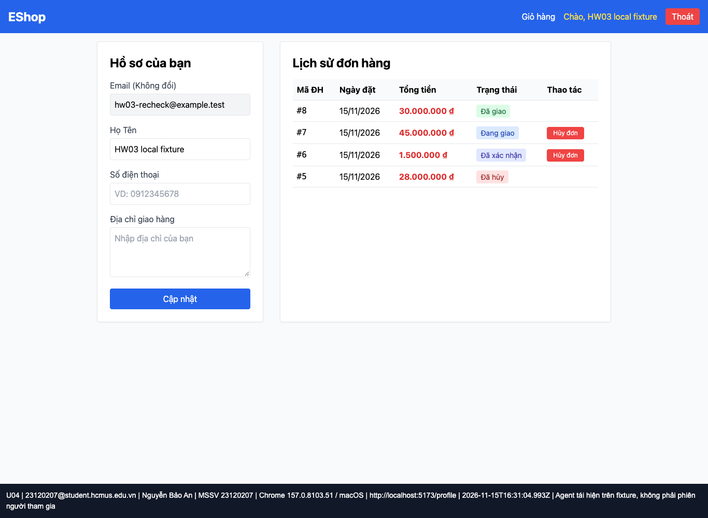

# U01: Lối vào lịch sử đơn qua lời chào khó nhận biết

Severity: **Major** (đề xuất, chờ human review). Loại: Vấn đề thiết kế lặp lại / heuristic.

Ghi chú nghiên cứu do sinh viên cung cấp: 5/7 phiên (P1, P2, P3, P5, P6). Không suy rộng tần suất ra ngoài mẫu này.

Môi trường tái hiện: Chrome 157.0.8103.51, macOS, localhost:5173; SUT `85af3ba875c88283615e22cb108f13e2fccaf0e9`. Thời điểm: 2026-11-15T16:31:04.577Z.

Tiền điều kiện: clone SUT riêng; tài khoản fixture và bốn đơn 28 triệu pending, 1,5 triệu confirmed, 45 triệu shipping, 30 triệu delivered. Dữ liệu fixture do agent tạo để tái hiện, không phải dữ liệu người tham gia.

Bước và kỳ vọng: Đăng nhập bằng tài khoản fixture; quan sát navbar và liên kết /profile. Kỳ vọng thiết kế: có lối vào Đơn hàng của tôi rõ nghĩa.

Thực tế: Link /profile có nhãn Chào, HW03 local fixture; không có nhãn Đơn hàng của tôi.

Đề xuất: Thêm liên kết 'Đơn hàng của tôi' rõ nghĩa và trực quan trên thanh điều hướng (Navbar).

Ảnh dưới đây do agent chụp khi tái hiện sau khi nhận hồ sơ, không phải ảnh/video phiên người tham gia. Tính xác thực phiên dựa vào xác nhận của sinh viên; ảnh này chỉ chứng minh trạng thái UI hiện tại.

GitHub Issue: https://github.com/NgBaoAnn/hw03-gui-usability/issues/24

# U02: Tiêu đề Đăng Ký trên form đăng nhập gây nhầm

Severity: **Minor** (đề xuất, chờ human review). Loại: Lỗi nhãn cụ thể.

Ghi chú nghiên cứu do sinh viên cung cấp: 3/7 phiên (P2, P3, P6). Không suy rộng tần suất ra ngoài mẫu này.

Môi trường tái hiện: Chrome 157.0.8103.51, macOS, localhost:5173; SUT `85af3ba875c88283615e22cb108f13e2fccaf0e9`. Thời điểm: 2026-11-15T16:31:04.324Z.

Tiền điều kiện: clone SUT riêng; tài khoản fixture và bốn đơn 28 triệu pending, 1,5 triệu confirmed, 45 triệu shipping, 30 triệu delivered. Dữ liệu fixture do agent tạo để tái hiện, không phải dữ liệu người tham gia.

Bước và kỳ vọng: Mở /login khi chưa đăng nhập. Kỳ vọng: tiêu đề mô tả chức năng đăng nhập.

Thực tế: Route /login có heading Đăng Ký; không phải form đăng ký.

Đề xuất: Đổi tiêu đề đúng chức năng đăng nhập và thống nhất nhãn tiếng Việt.

Ảnh dưới đây do agent chụp khi tái hiện sau khi nhận hồ sơ, không phải ảnh/video phiên người tham gia. Tính xác thực phiên dựa vào xác nhận của sinh viên; ảnh này chỉ chứng minh trạng thái UI hiện tại.

GitHub Issue: https://github.com/NgBaoAnn/hw03-gui-usability/issues/25

# U03: Nút Hủy xuất hiện ở đơn đang giao gây hoang mang kỳ vọng

Severity: **Major** (đề xuất, chờ human review). Loại: Affordance không khớp trạng thái.

Ghi chú nghiên cứu do sinh viên cung cấp: 3/7 phiên (P1, P4, P7). Không suy rộng tần suất ra ngoài mẫu này.

Môi trường tái hiện: Chrome 157.0.8103.51, macOS, localhost:5173; SUT `85af3ba875c88283615e22cb108f13e2fccaf0e9`. Thời điểm: 2026-11-15T16:31:04.729Z.

Tiền điều kiện: clone SUT riêng; tài khoản fixture và bốn đơn 28 triệu pending, 1,5 triệu confirmed, 45 triệu shipping, 30 triệu delivered. Dữ liệu fixture do agent tạo để tái hiện, không phải dữ liệu người tham gia.

Bước và kỳ vọng: Đăng nhập tài khoản có đơn shipping; mở /profile; quan sát cột Thao tác. Kỳ vọng: không mời người dùng thực hiện hành động không phù hợp trạng thái shipping theo FR-10. Lượt này chưa click hủy đơn shipping.

Thực tế: Dòng Đang giao vẫn có nút Hủy đơn; chỉ chứng minh affordance UI, chưa khẳng định backend cho hủy shipping.

Đề xuất: Ẩn nút Hủy đơn đối với các đơn hàng đã ở trạng thái đang giao (shipping), đồng bộ giao diện với quy tắc nghiệp vụ.

Ảnh dưới đây do agent chụp khi tái hiện sau khi nhận hồ sơ, không phải ảnh/video phiên người tham gia. Tính xác thực phiên dựa vào xác nhận của sinh viên; ảnh này chỉ chứng minh trạng thái UI hiện tại.

GitHub Issue: https://github.com/NgBaoAnn/hw03-gui-usability/issues/26

# U04: Thiếu hộp thoại xác nhận (Confirmation Modal) trước khi hủy đơn

Severity: **Major** (đề xuất, chờ human review). Loại: Vấn đề thiết kế lặp lại / heuristic.

Ghi chú nghiên cứu do sinh viên cung cấp: 3/7 phiên (P3, P5, P6). Không suy rộng tần suất ra ngoài mẫu này.

Môi trường tái hiện: Chrome 157.0.8103.51, macOS, localhost:5173; SUT `85af3ba875c88283615e22cb108f13e2fccaf0e9`. Thời điểm: 2026-11-15T16:31:04.993Z.

Tiền điều kiện: clone SUT riêng; tài khoản fixture và bốn đơn 28 triệu pending, 1,5 triệu confirmed, 45 triệu shipping, 30 triệu delivered. Dữ liệu fixture do agent tạo để tái hiện, không phải dữ liệu người tham gia.

Bước và kỳ vọng: Ở /profile có đơn pending; bấm Hủy đơn đúng một lần; ghi mọi native dialog. Kỳ vọng heuristic: có xác nhận trước thao tác hủy khó hoàn tác.

Thực tế: Một click hủy pending; chỉ có alert sau thao tác, không có confirm trước thao tác. Dialog log: [{"type":"alert","message":"Hủy đơn thành công!"}]

Đề xuất: Bổ sung popup/dialog xác nhận 'Bạn có chắc chắn muốn hủy đơn hàng này không?' trước khi thực thi hủy đơn.

Ảnh dưới đây do agent chụp khi tái hiện sau khi nhận hồ sơ, không phải ảnh/video phiên người tham gia. Tính xác thực phiên dựa vào xác nhận của sinh viên; ảnh này chỉ chứng minh trạng thái UI hiện tại.

GitHub Issue: https://github.com/NgBaoAnn/hw03-gui-usability/issues/27

# U05: Nhận diện đơn hàng chỉ dựa trên mã và số tiền gây tốn công nhận thức

Severity: **Minor** (đề xuất, chờ human review). Loại: Vấn đề thiết kế lặp lại / heuristic.

Ghi chú nghiên cứu do sinh viên cung cấp: 4/7 phiên (P1, P2, P5, P7). Không suy rộng tần suất ra ngoài mẫu này.

Môi trường tái hiện: Chrome 157.0.8103.51, macOS, localhost:5173; SUT `85af3ba875c88283615e22cb108f13e2fccaf0e9`. Thời điểm: 2026-11-15T16:31:04.793Z.

Tiền điều kiện: clone SUT riêng; tài khoản fixture và bốn đơn 28 triệu pending, 1,5 triệu confirmed, 45 triệu shipping, 30 triệu delivered. Dữ liệu fixture do agent tạo để tái hiện, không phải dữ liệu người tham gia.

Bước và kỳ vọng: Ở /profile có bốn đơn khác trạng thái; đọc cột của bảng Lịch sử đơn hàng. Kỳ vọng thiết kế: có thông tin sản phẩm để nhận diện đơn; đây là đề xuất UX, không khẳng định yêu cầu FR bắt buộc.

Thực tế: Danh sách đơn không hiển thị tên/ảnh sản phẩm; đây là đề xuất UX, không phải vi phạm FR đã chứng minh.

Đề xuất: Hiển thị tên tóm tắt hoặc ảnh sản phẩm đại diện trong danh sách đơn hàng để người dùng dễ nhận diện.

Ảnh dưới đây do agent chụp khi tái hiện sau khi nhận hồ sơ, không phải ảnh/video phiên người tham gia. Tính xác thực phiên dựa vào xác nhận của sinh viên; ảnh này chỉ chứng minh trạng thái UI hiện tại.

GitHub Issue: https://github.com/NgBaoAnn/hw03-gui-usability/issues/28

