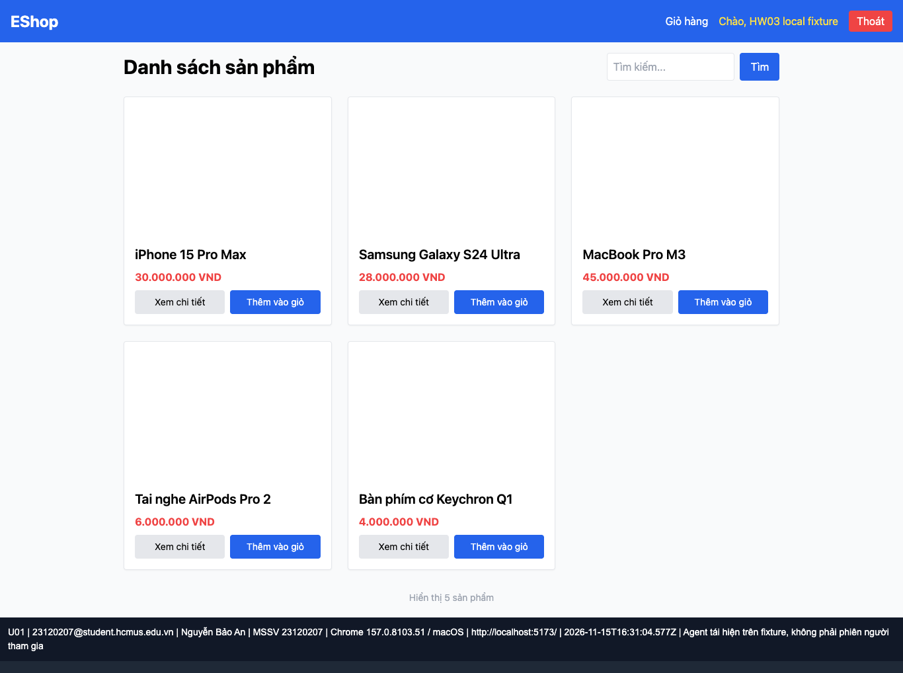

# U01: Lối vào lịch sử đơn qua lời chào khó nhận biết

Severity: **Major** (đề xuất, chờ human review). Loại: Vấn đề thiết kế lặp lại / heuristic.

Ghi chú nghiên cứu do sinh viên cung cấp: 5/7 phiên (P1, P2, P3, P5, P6). Không suy rộng tần suất ra ngoài mẫu này.

Môi trường tái hiện: Chrome 157.0.8103.51, macOS, localhost:5173; SUT `85af3ba875c88283615e22cb108f13e2fccaf0e9`. Thời điểm: 2026-11-15T16:31:04.577Z.

Tiền điều kiện: clone SUT riêng; tài khoản fixture và bốn đơn 28 triệu pending, 1,5 triệu confirmed, 45 triệu shipping, 30 triệu delivered. Dữ liệu fixture do agent tạo để tái hiện, không phải dữ liệu người tham gia.

Bước và kỳ vọng: Đăng nhập bằng tài khoản fixture; quan sát navbar và liên kết /profile. Kỳ vọng thiết kế: có lối vào Đơn hàng của tôi rõ nghĩa.

Thực tế: Link /profile có nhãn Chào, HW03 local fixture; không có nhãn Đơn hàng của tôi.

Đề xuất: Thêm liên kết 'Đơn hàng của tôi' rõ nghĩa và trực quan trên thanh điều hướng (Navbar).

Ảnh dưới đây do agent chụp khi tái hiện sau khi nhận hồ sơ, không phải ảnh/video phiên người tham gia. Tính xác thực phiên dựa vào xác nhận của sinh viên; ảnh này chỉ chứng minh trạng thái UI hiện tại.

GitHub Issue: https://github.com/NgBaoAnn/hw03-gui-usability/issues/24

