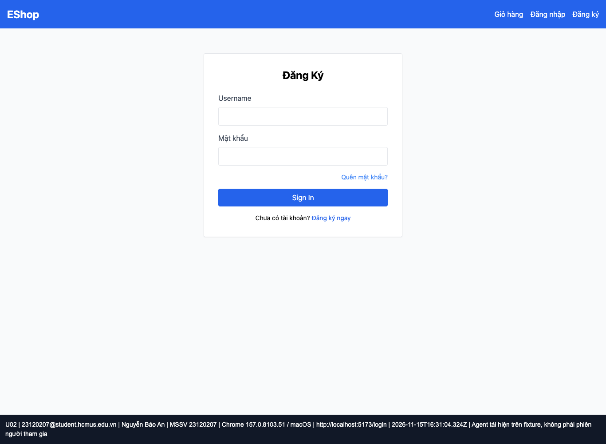

# U02: Tiêu đề Đăng Ký trên form đăng nhập gây nhầm

Severity: **Minor** (đề xuất, chờ human review). Loại: Lỗi nhãn cụ thể.

Ghi chú nghiên cứu do sinh viên cung cấp: 3/7 phiên (P2, P3, P6). Không suy rộng tần suất ra ngoài mẫu này.

Môi trường tái hiện: Chrome 157.0.8103.51, macOS, localhost:5173; SUT `85af3ba875c88283615e22cb108f13e2fccaf0e9`. Thời điểm: 2026-11-15T16:31:04.324Z.

Tiền điều kiện: clone SUT riêng; tài khoản fixture và bốn đơn 28 triệu pending, 1,5 triệu confirmed, 45 triệu shipping, 30 triệu delivered. Dữ liệu fixture do agent tạo để tái hiện, không phải dữ liệu người tham gia.

Bước và kỳ vọng: Mở /login khi chưa đăng nhập. Kỳ vọng: tiêu đề mô tả chức năng đăng nhập.

Thực tế: Route /login có heading Đăng Ký; không phải form đăng ký.

Đề xuất: Đổi tiêu đề đúng chức năng đăng nhập và thống nhất nhãn tiếng Việt.

Ảnh dưới đây do agent chụp khi tái hiện sau khi nhận hồ sơ, không phải ảnh/video phiên người tham gia. Tính xác thực phiên dựa vào xác nhận của sinh viên; ảnh này chỉ chứng minh trạng thái UI hiện tại.

GitHub Issue: https://github.com/NgBaoAnn/hw03-gui-usability/issues/25

