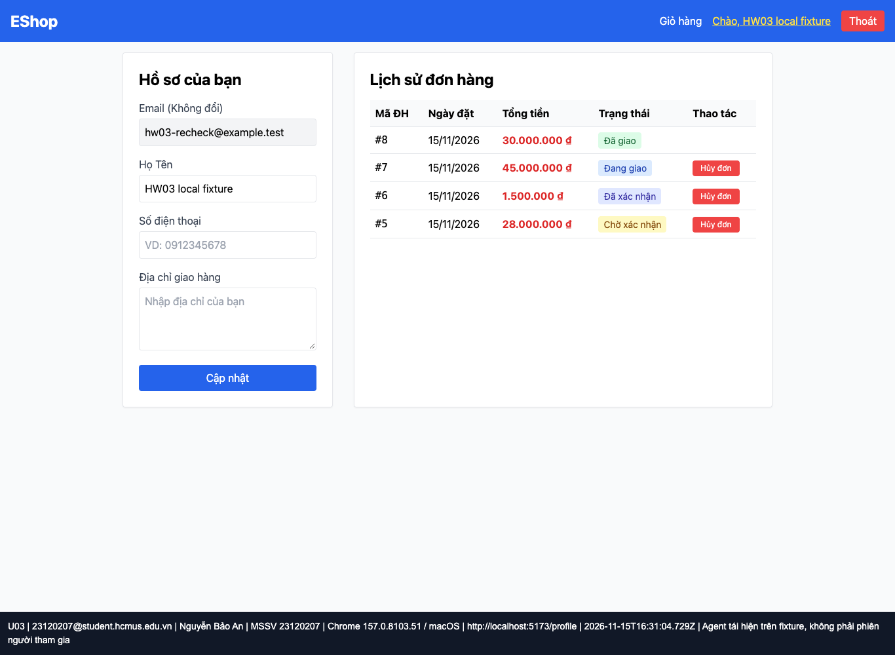

# U03: Nút Hủy xuất hiện ở đơn đang giao gây hoang mang kỳ vọng

Severity: **Major** (đề xuất, chờ human review). Loại: Affordance không khớp trạng thái.

Ghi chú nghiên cứu do sinh viên cung cấp: 3/7 phiên (P1, P4, P7). Không suy rộng tần suất ra ngoài mẫu này.

Môi trường tái hiện: Chrome 157.0.8103.51, macOS, localhost:5173; SUT `85af3ba875c88283615e22cb108f13e2fccaf0e9`. Thời điểm: 2026-11-15T16:31:04.729Z.

Tiền điều kiện: clone SUT riêng; tài khoản fixture và bốn đơn 28 triệu pending, 1,5 triệu confirmed, 45 triệu shipping, 30 triệu delivered. Dữ liệu fixture do agent tạo để tái hiện, không phải dữ liệu người tham gia.

Bước và kỳ vọng: Đăng nhập tài khoản có đơn shipping; mở /profile; quan sát cột Thao tác. Kỳ vọng: không mời người dùng thực hiện hành động không phù hợp trạng thái shipping theo FR-10. Lượt này chưa click hủy đơn shipping.

Thực tế: Dòng Đang giao vẫn có nút Hủy đơn; chỉ chứng minh affordance UI, chưa khẳng định backend cho hủy shipping.

Đề xuất: Ẩn nút Hủy đơn đối với các đơn hàng đã ở trạng thái đang giao (shipping), đồng bộ giao diện với quy tắc nghiệp vụ.

Ảnh dưới đây do agent chụp khi tái hiện sau khi nhận hồ sơ, không phải ảnh/video phiên người tham gia. Tính xác thực phiên dựa vào xác nhận của sinh viên; ảnh này chỉ chứng minh trạng thái UI hiện tại.

GitHub Issue: https://github.com/NgBaoAnn/hw03-gui-usability/issues/26

