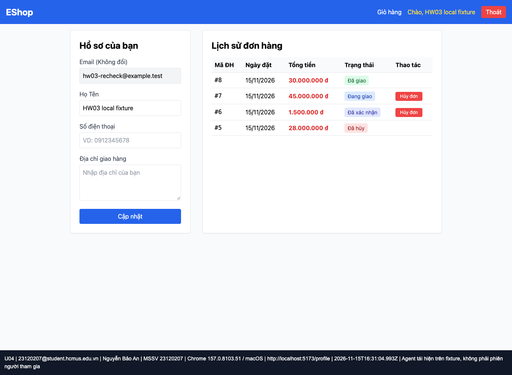

# U04: Thiếu hộp thoại xác nhận (Confirmation Modal) trước khi hủy đơn

Severity: **Major** (đề xuất, chờ human review). Loại: Vấn đề thiết kế lặp lại / heuristic.

Ghi chú nghiên cứu do sinh viên cung cấp: 3/7 phiên (P3, P5, P6). Không suy rộng tần suất ra ngoài mẫu này.

Môi trường tái hiện: Chrome 157.0.8103.51, macOS, localhost:5173; SUT `85af3ba875c88283615e22cb108f13e2fccaf0e9`. Thời điểm: 2026-11-15T16:31:04.993Z.

Tiền điều kiện: clone SUT riêng; tài khoản fixture và bốn đơn 28 triệu pending, 1,5 triệu confirmed, 45 triệu shipping, 30 triệu delivered. Dữ liệu fixture do agent tạo để tái hiện, không phải dữ liệu người tham gia.

Bước và kỳ vọng: Ở /profile có đơn pending; bấm Hủy đơn đúng một lần; ghi mọi native dialog. Kỳ vọng heuristic: có xác nhận trước thao tác hủy khó hoàn tác.

Thực tế: Một click hủy pending; chỉ có alert sau thao tác, không có confirm trước thao tác. Dialog log: [{"type":"alert","message":"Hủy đơn thành công!"}]

Đề xuất: Bổ sung popup/dialog xác nhận 'Bạn có chắc chắn muốn hủy đơn hàng này không?' trước khi thực thi hủy đơn.

Ảnh dưới đây do agent chụp khi tái hiện sau khi nhận hồ sơ, không phải ảnh/video phiên người tham gia. Tính xác thực phiên dựa vào xác nhận của sinh viên; ảnh này chỉ chứng minh trạng thái UI hiện tại.

GitHub Issue: https://github.com/NgBaoAnn/hw03-gui-usability/issues/27

