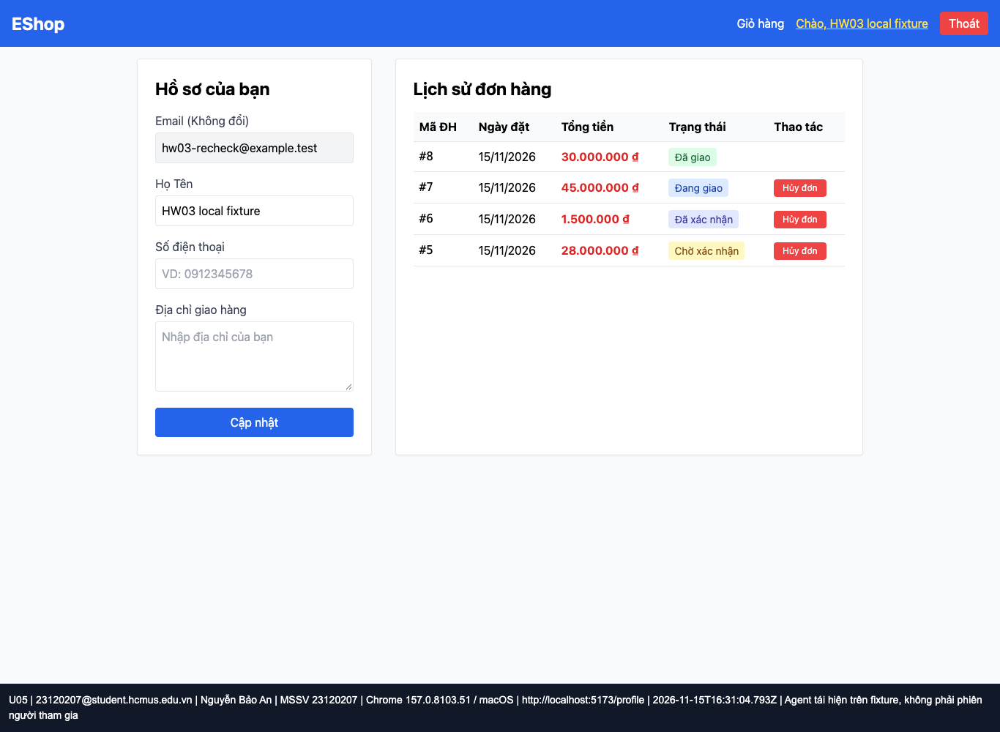

# U05: Nhận diện đơn hàng chỉ dựa trên mã và số tiền gây tốn công nhận thức

Severity: **Minor** (đề xuất, chờ human review). Loại: Vấn đề thiết kế lặp lại / heuristic.

Ghi chú nghiên cứu do sinh viên cung cấp: 4/7 phiên (P1, P2, P5, P7). Không suy rộng tần suất ra ngoài mẫu này.

Môi trường tái hiện: Chrome 157.0.8103.51, macOS, localhost:5173; SUT `85af3ba875c88283615e22cb108f13e2fccaf0e9`. Thời điểm: 2026-11-15T16:31:04.793Z.

Tiền điều kiện: clone SUT riêng; tài khoản fixture và bốn đơn 28 triệu pending, 1,5 triệu confirmed, 45 triệu shipping, 30 triệu delivered. Dữ liệu fixture do agent tạo để tái hiện, không phải dữ liệu người tham gia.

Bước và kỳ vọng: Ở /profile có bốn đơn khác trạng thái; đọc cột của bảng Lịch sử đơn hàng. Kỳ vọng thiết kế: có thông tin sản phẩm để nhận diện đơn; đây là đề xuất UX, không khẳng định yêu cầu FR bắt buộc.

Thực tế: Danh sách đơn không hiển thị tên/ảnh sản phẩm; đây là đề xuất UX, không phải vi phạm FR đã chứng minh.

Đề xuất: Hiển thị tên tóm tắt hoặc ảnh sản phẩm đại diện trong danh sách đơn hàng để người dùng dễ nhận diện.

Ảnh dưới đây do agent chụp khi tái hiện sau khi nhận hồ sơ, không phải ảnh/video phiên người tham gia. Tính xác thực phiên dựa vào xác nhận của sinh viên; ảnh này chỉ chứng minh trạng thái UI hiện tại.

GitHub Issue: https://github.com/NgBaoAnn/hw03-gui-usability/issues/28

